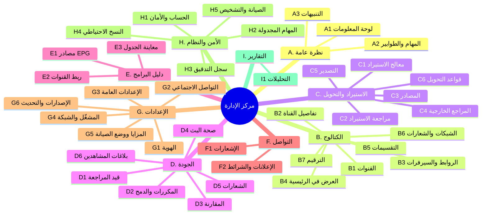
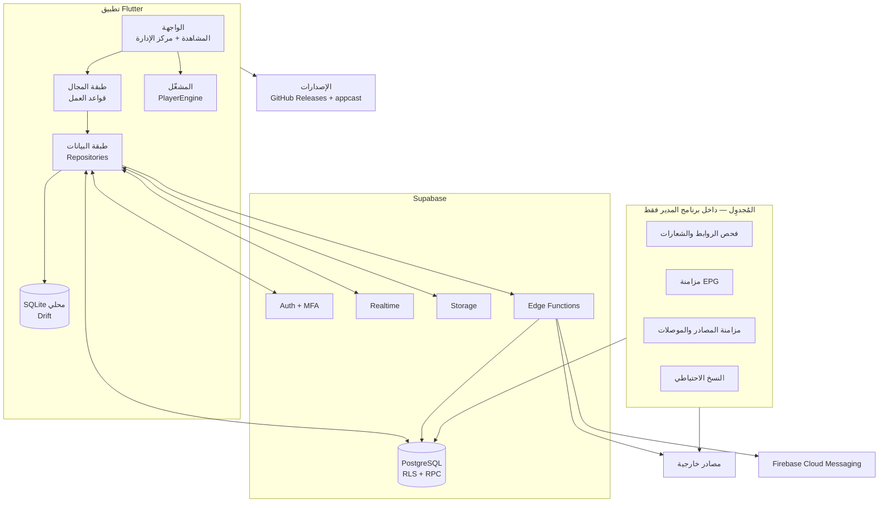
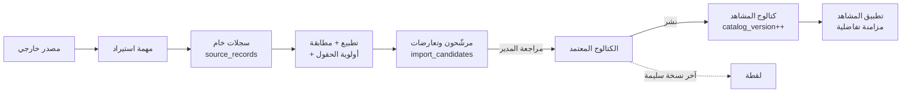
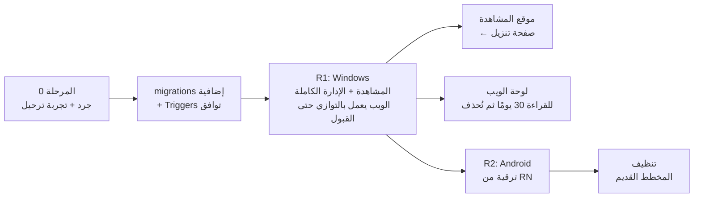
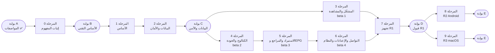

<div align="center">

# MTC-iPTv — الوثيقة الرئيسية للمشروع

**المواصفات والمعمارية ولوحة التحكم وخطة التنفيذ للمنصّة الموحّدة (Flutter)**

`الإصدار 2.7 — المرحلة 2: الخادم والأمان — 2026-10-15`

| | |
|---|---|
| **المنتج** | MTC-iPTv |
| **الشركة الأم** | مجموعة شركات مركز تكنولوجيا الشرق الأوسط — MTC-Group<br>_Middle East Technology Center Group_ |
| **برمجة وتطوير** | أنيس عدوان — Anees Adwan |
| **التقنية** | Flutter / Dart — قاعدة كود واحدة لكل المنصّات |
| **الإصدار الأول (R1)** | Windows (سطح المكتب): المشاهدة + الإدارة الكاملة |
| **المنصّات اللاحقة (مخطط لها)** | R2: Android (جوال، تابلت، Android TV، TV Box) — R3: macOS |
| **الخادم** | Supabase (PostgreSQL + Auth + Storage + Edge Functions) |
| **المهام المجدولة** | تعمل داخل برنامج المدير (D-13) |

</div>

---

## قواعد قراءة هذه الوثيقة

> **1. لا تُعتبر أي ميزة منفّذة لمجرد ورودها هنا.** لكل ميزة حالة واحدة من خمس، ولا تنتقل لحالة إلا بدليل موثّق:
>
> | الحالة | المعنى | الدليل المطلوب |
> |---|---|---|
> | `مصمَّم` | موصوف في هذه الوثيقة | — |
> | `قيد التنفيذ` | العمل جارٍ | فرع أو مهمة مفتوحة |
> | `منفّذ` | الكود مكتمل | دمج في الفرع الرئيسي |
> | `مُختبَر` | اجتاز اختباراته | تقرير اختبار |
> | `مقبول` | اعتمده المالك ضمن إصدار | قائمة قبول الإصدار موقّعة |
>
> **2. لا يُعتبر أي قرار معتمدًا إلا بموافقة صريحة من المالك.** حالات القرارات في §5 فقط.
>
> **3. لا يُعلن دعم منصّة بناءً على وجود الكود.** الدعم يُعلن بعد اجتياز اختبارات تلك المنصّة نفسها (§4.4).
>
> **4. عند تعارض جزأين من الوثيقة** يُوثَّق التعارض ويُحسم بقرار صريح في §5، ولا يُختار أحدهما بصمت.

---

## فهرس المحتويات

**الجزء الأول — الأساس**
1. [الملخص التنفيذي](#1-الملخص-التنفيذي)
2. [الأهداف ومؤشرات النجاح](#2-الأهداف-ومؤشرات-النجاح)
3. [النطاق وحدوده](#3-النطاق-وحدوده)
4. [الإصدارات ونطاق كل منها](#4-الإصدارات-ونطاق-كل-منها)
5. [سجل القرارات الموحّد](#5-سجل-القرارات-الموحّد)

**الجزء الثاني — المنتج**

6. [الهوية وتجربة الاستخدام](#6-الهوية-وتجربة-الاستخدام)
7. [المشغّل — القلب التقني للمشروع](#7-المشغّل--القلب-التقني-للمشروع)
8. [تطبيق المشاهدة](#8-تطبيق-المشاهدة)
9. [لوحة التحكم — إعادة التصميم الكاملة](#9-لوحة-التحكم--إعادة-التصميم-الكاملة)
10. [الاستيراد والتحويل والتصدير](#10-الاستيراد-والتحويل-والتصدير)
11. [المطابقة وأولوية المصادر والتكرار والمقارنة](#11-المطابقة-وأولوية-المصادر-والتكرار-والمقارنة)
12. [فحص القنوات — التعريف الرسمي](#12-فحص-القنوات--التعريف-الرسمي)
13. [المراجع الخارجية وعقد الموصلات](#13-المراجع-الخارجية-وعقد-الموصلات)
14. [الإشعارات](#14-الإشعارات)

**الجزء الثالث — التقنية**

15. [المعمارية](#15-المعمارية)
16. [نموذج البيانات](#16-نموذج-البيانات)
17. [الخدمات الخلفية والمهام المجدولة](#17-الخدمات-الخلفية-والمهام-المجدولة)
18. [التوزيع والتحديثات](#18-التوزيع-والتحديثات)
19. [الأمن](#19-الأمن)
20. [الخصوصية والبيانات المجمّعة](#20-الخصوصية-والبيانات-المجمّعة)
21. [النسخ الاحتياطي والاستعادة](#21-النسخ-الاحتياطي-والاستعادة)
22. [الأداء والعمل دون اتصال](#22-الأداء-والعمل-دون-اتصال)
23. [هيكل المشروع](#23-هيكل-المشروع)

**الجزء الرابع — التنفيذ**

24. [الانتقال وترحيل البيانات](#24-الانتقال-وترحيل-البيانات)
25. [خطة التنفيذ وبوابات الاعتماد](#25-خطة-التنفيذ-وبوابات-الاعتماد)
26. [الاختبارات ومعايير القبول](#26-الاختبارات-ومعايير-القبول)
27. [الوثائق ومخرجات التسليم](#27-الوثائق-ومخرجات-التسليم)
28. [المراجع والروابط](#28-المراجع-والروابط)

**الملاحق**
- [ملحق أ: جرد ميزات النظام الحالي ومصيرها](#ملحق-أ-جرد-ميزات-النظام-الحالي-ومصيرها)
- [ملحق ب: سجل الشاشات](#ملحق-ب-سجل-الشاشات)
- [ملحق ج: بروتوكول اختبار المشغّل](#ملحق-ج-بروتوكول-اختبار-المشغّل)
- [ملحق د: جدول ربط حقول الترحيل](#ملحق-د-جدول-ربط-حقول-الترحيل)
- [ملحق هـ: مسرد المصطلحات](#ملحق-هـ-مسرد-المصطلحات)
- [سجل تغييرات الوثيقة](#سجل-تغييرات-الوثيقة)

---

# الجزء الأول — الأساس

## 1. الملخص التنفيذي

يُعاد بناء MTC-iPTv كـ**منصّة واحدة مكتوبة بـ Flutter**. تبدأ بتطبيق Windows، والبنية مصمَّمة لتخرج من نفس الكود نسخ Android (جوال وتابلت وTV) وmacOS لاحقًا. التطبيق الجديد يحلّ تدريجيًا محلّ ثلاثة أنظمة حالية:

| النظام الحالي | مصيره | متى |
|---|---|---|
| موقع المشاهدة على الويب (GitHub Pages) | يتحوّل إلى صفحة تنزيل | بعد قبول R1 |
| لوحة الإدارة على الويب (`asadmin/`) | تُلغى، وتنتقل كل وظائفها إلى «مركز الإدارة» | بعد قبول R1 (للقراءة 30 يومًا ثم تُحذف) |
| تطبيق Android بـ React Native (`app/`) | يُستبدل بنسخة Flutter **بنفس معرّف الحزمة ومفتاح التوقيع** بعد اختبار ترقية فعلي | R2 |

**يتكوّن التطبيق من جزأين داخل برنامج واحد:**

1. **تجربة المشاهدة:** مشغّل مبني على محرّك **mpv** (مرشّح، ويُحسم بإثبات المفهوم) يشغّل HLS وMPEG-TS وHEVC وAC3 وغيرها بلا قيود المتصفح، مع دليل البرامج والمفضلة ووضع التلفاز.
2. **مركز الإدارة:** يظهر فقط لحساب المدير بعد تسجيل الدخول بخطوتين، وصلاحياته مفروضة على الخادم. ويشغّل المهام المجدولة (الفحص، EPG، المصادر، النسخ) من جهاز المدير. يدير القنوات والمصادر والاستيراد والتحويل والفحص والمقارنة ودليل البرامج والإشعارات والإصدارات والإعدادات والهوية والتواصل الاجتماعي والنسخ الاحتياطي وسجل التدقيق.

**المبادئ الحاكمة:**

- **المشاهد لا يضيف روابط.** كل ما يراه يأتي من كتالوج مركزي يعتمده المدير.
- **الواجهة لا تحمل أسرارًا.** العمليات الحساسة تُنفَّذ في خدمات خلفية موثوقة، والصلاحيات تُفرض في قاعدة البيانات.
- **لا شيء جديد يُنشر تلقائيًا.** كل استيراد يمرّ بمنطقة مراجعة قبل الكتالوج المنشور، وهذا امتداد لـ«بوابة المراجعة» الموجودة اليوم.
- **تعديلات المدير اليدوية محمية.** لا يكتب مصدر خارجي فوق حقل عدّله المدير بيده (§11.2).
- **التشغيل الفعلي هو الحَكَم.** صحة القناة تُقاس من محاولات تشغيل حقيقية، لا من فحص HTTP وحده.
- **الإثبات قبل البناء.** لا يبدأ بناء الشاشات الكثيرة قبل نجاح إثبات مفهوم المشغّل وتجربة ترحيل البيانات (§25).

---

## 2. الأهداف ومؤشرات النجاح

> المؤشرات المعلَّمة بـ 🧪 **مبدئية**، وتُثبَّت قيمتها النهائية بعد إثبات المفهوم (المرحلة 0) على عيّنة حقيقية، وفق طريقة القياس الموثّقة.

| # | الهدف | المؤشر | طريقة القياس |
|---|---|---|---|
| G1 | تشغيل كل قناة يعمل رابطها فعليًا | **≥ 95%** — ✅ مُقاس: **98.3%** (115/117، `docs/poc/player-2026-10-14.md`) | **المقام:** عيّنات ملحق ج التي نجحت في VLC على نفس الجهاز والشبكة وخلال 10 دقائق. **البسط:** منها ما نجح في التطبيق. **النجاح:** أول إطار ≤ 15 ثانية + تشغيل دون توقف > 5 ثوانٍ. يُعاد قياسه بـ media_kit قبل بوابة B |
| G2 | بدء تشغيل سريع | **الوسيط ≤ 2.5 ث، P90 ≤ 5 ث** — ✅ مُقاس: **1.50 / 3.94 ث** (بشرط اختيار الجودة مسبقًا §7.4) | من الضغط حتى أول إطار، على اتصال المدير، للقنوات الناجحة |
| G3 | تبديل سلس للسيرفر عند الفشل | ≤ 6 ثوانٍ | من لحظة الفشل حتى بدء الرابط التالي، دون تدخل المشاهد |
| G4 | لوحة تحكم كاملة تغني عن الويب | 100% | كل بند في ملحق أ له حالة `مقبول` أو قرار إلغاء موثّق |
| G5 | كتالوج نظيف | صفر | قنوات منشورة مكررة (نفس `dup_key`)، أو بلا رابط مفعّل |
| G6 | تحديثات موثوقة | 100% | اجتياز سيناريوهات فشل التحديث في §18.4 |
| G7 | واجهة عربية أصيلة | صفر | عناصر مقلوبة أو متداخلة في Golden tests بالعربية والإنجليزية |
| G8 | أداء مع الكتالوج الكبير | 🧪 60fps / ≤ 150ms | تمرير قائمة 10,000 قناة، والبحث المحلي |
| G9 | أمان | صفر | مفاتيح سرية في الحزمة، أو عملية إدارية تنجح لغير المصرّح له (pgTAP) |

---

## 3. النطاق وحدوده

### 3.1 ضمن النطاق الكلي للمشروع

- تطبيق Flutter واحد لـ Windows أولًا، مصمَّم ليعمل لاحقًا على Android (بما فيه TV) وmacOS.
- مشغّل بث داخل التطبيق، بعد اجتياز إثبات المفهوم.
- مركز إدارة داخل التطبيق لمدير واحد (D-05)، بصلاحيات مفروضة على الخادم.
- جدولة المهام الدورية داخل برنامج المدير (D-13).
- كتالوج مركزي: القنوات والروابط والفئات والدول واللغات والشعارات والشبكات.
- الاستيراد والتحويل والتصدير بصيغ متعددة، مع منطقة مراجعة.
- المطابقة وأولوية المصادر وكشف التكرار والمقارنة والدمج.
- فحص صحة الروابط والشعارات، ومقاييس التشغيل الفعلية.
- دليل البرامج (EPG): المصادر والربط والمزامنة والمعاينة.
- الإشعارات، والإعدادات عن بُعد، والهوية، والتواصل الاجتماعي.
- إدارة الإصدارات والتحديثات والتوقيع.
- المستخدمون والأدوار وسجل التدقيق والنسخ الاحتياطي والاستعادة.
- ترحيل البيانات من النظام الحالي.

### 3.2 خارج النطاق ما لم يُعتمد صراحةً

- إعادة بث محتوى بلا تصريح، أو تجاوز DRM أو المصادقة أو القيود الجغرافية.
- استخراج روابط خاصة أو غير موثّقة من منصّات تجارية.
- حسابات مشاهدين كاملة باشتراكات ودفع (البنية تسمح بها لاحقًا).
- التسجيل (DVR) والبث المؤجّل (Timeshift): مرحلة لاحقة اختيارية (§8.6).
- التثبيت الصامت أو رفع الصلاحيات دون موافقة المستخدم.
- iOS وLinux.

---

## 4. الإصدارات ونطاق كل منها

> **قرار المالك (D-15):** النسخة الأولى تضم **المشاهدة والإدارة الكاملة**، فيُلغى الويب كاملًا بعد قبولها. الثمن: R1 يحتاج وقتًا أطول قبل وصوله للمستخدمين. التخفيف: نسخ `beta` داخلية متتالية (§25) تختبر المشغّل مبكرًا.

### 4.1 R1 — Windows: المشاهدة + الإدارة الكاملة (`3.0.0`)

| المجال | ضمن R1 |
|---|---|
| الأساس | المشروع، العربية والإنجليزية وRTL وLTR، الثيمان، التنقل بلوحة المفاتيح |
| المشاهدة | كل شاشات V-01 إلى V-12، المشغّل، وضع التلفاز، المفضلة، الدليل، التذكيرات، المشغّل المصغّر |
| البيانات | المصادقة بخطوتين، RLS، المزامنة التفاضلية، سجل التدقيق، أولوية الحقول |
| الإدارة | **كل الشاشات الـ 39** (ملحق ب) |
| المهام المجدولة | داخل برنامج المدير: الفحص، EPG، المصادر والموصلات، النسخ الاحتياطي (§17) |
| التوزيع | مثبّت **غير موقّع حاليًا** (D-07) + تحديث تلقائي بحزم موقّعة بـ DSA ومُتحقَّق من بصمتها |
| الويب | يعمل بالتوازي حتى قبول R1، ثم يتوقف (§24) |

### 4.2 R2 وR3 — المنصّات الأخرى

| الإصدار | المنصّة | شرط البدء |
|---|---|---|
| R2 | Android (جوال، تابلت) + Android TV | قبول R1 + نجاح اختبار الترقية من React Native (§24.6) |
| R3 | macOS | قبول R1 + حسم D-12 (جهاز Mac أو بناء سحابي + حساب Apple Developer) |

### 4.3 بعد R1 (`3.x`)

مزايا مؤجلة عمدًا لتسريع R1: المشاهدة المتعددة (2×2)، لقطة الشاشة، مؤقّت النوم، التسجيل والبث المؤجّل، موصلات المراجع ذات الأولوية 3، التوقيع الرقمي (D-07).

### 4.4 مصفوفة دعم المنصّات

> تُحدَّث مع كل إصدار. **«مدعوم» = اجتاز اختبارات تلك المنصّة فعليًا.**

| المنصّة | الحالة الآن | الإصدار المستهدف | ملاحظات |
|---|---|---|---|
| Windows 10 (21H2+) و11، x64 | مخطط | R1 | المنصّة المرجعية |
| Windows على ARM64 | غير مخطط | — | يُدرس لاحقًا |
| Android 7+ (جوال وتابلت) | مخطط | R2 | — |
| Android TV / TV Box (Android 7+) | مخطط | R2 | تنقل بالريموت |
| macOS 11+ (Intel وApple Silicon) | مخطط | R3 | توقيع وتوثيق Apple |
| iOS / Linux | خارج النطاق | — | — |

**نتائج Windows لا تُعمَّم على غيرها.** لكل منصّة قائمة قبول خاصة (§26.3).

---

## 5. سجل القرارات الموحّد

> **هذا هو المكان الوحيد** لحالة أي قرار في المشروع. كل قرار تقني له ملف ADR في `docs/adr/` (السياق، الخيارات، القرار، العواقب، تاريخ الاعتماد).
>
> **الحالات:** `مقترح` · `معتمد` · `مرفوض` (مع السبب) · `مؤجل` · `مستبدل` (مع رقم القرار الجديد).
> **المسؤول:** أنيس عدوان (المالك). **تاريخ اعتماد كل القرارات المعتمدة أدناه:** 2026-10-14.
> **«يمنع»:** المرحلة التي لا تبدأ قبل حسم القرار.

### 5.1 ملخص الحالة

| الحالة | العدد | القرارات |
|---|---|---|
| ✅ معتمد | 30 | ADR-01، 02، 03–11، 13–15، 17 · D-01–D-10، D-13–D-17 |
| 🟡 مقترح | 2 | ADR-16 (ينتظر اختبار الترقية)، ADR-18 (ينتظر تجربة الترحيل) |
| ⏸ مؤجل | 3 | ADR-12، D-11، D-12 |

**لا يوجد قرار مفتوح يمنع بدء المرحلة 0.**

### 5.2 القرارات التقنية (ADR)

| # | القرار | الاختيار | الحالة | الشرط أو الخطوة التالية | البديل وسبب استبعاده |
|---|---|---|---|---|---|
| ADR-01 | تقنية الواجهة | **Flutter / Dart** | ✅ معتمد | — | Electron/Tauri: محرّك المتصفح لا يشغّل AC3 وHEVC وTS بموثوقية. C#/WPF: لا يخرج لـ Android وmacOS |
| ADR-02 | محرّك التشغيل | **media_kit (libmpv)** | ✅ معتمد (2026-10-15) | — | LibVLC: احتياطي إن ظهرت فئة روابط لا يشغّلها mpv |
| ADR-03 | الخادم | **Supabase** + كتالوج محلي (= D-02) | ✅ معتمد | — | VPS خاص: صيانة وأمان ونسخ على عاتقنا |
| ADR-04 | إدارة الحالة | **Riverpod** | ✅ معتمد | — | Bloc: أطول كودًا |
| ADR-05 | التوجيه | **go_router** | ✅ معتمد | — | — |
| ADR-06 | التخزين المحلي | **Drift (SQLite)** + FTS5 | ✅ معتمد | — | Hive/Isar: أضعف في الاستعلامات |
| ADR-07 | النماذج | **freezed + json_serializable** | ✅ معتمد | — | — |
| ADR-08 | التوطين | **flutter_localizations + ARB** | ✅ معتمد | — | — |
| ADR-09 | نافذة سطح المكتب | **window_manager + tray_manager** | ✅ معتمد | — | — |
| ADR-10 | تحديث سطح المكتب | **auto_updater** (WinSparkle/Sparkle) | ✅ معتمد | يُتحقق عمليًا في المرحلة 0 | Velopack: دعم Dart مجتمعي |
| ADR-11 | مثبّت Windows | **Inno Setup** | ✅ معتمد | يُتحقق عمليًا في المرحلة 0 | MSIX: قيود إضافية |
| ADR-12 | توقيع Windows (Authenticode) | — | ⏸ مؤجل (D-07) | يُعاد فتحه بعد R1 | — |
| ADR-13 | Push على Android | **FCM** (القائم) | ✅ معتمد | — | — |
| ADR-14 | إشعارات سطح المكتب | **Realtime + صندوق وارد + إشعار النظام** | ✅ معتمد | — | لا FCM لسطح المكتب في Flutter |
| ADR-15 | المهام الثقيلة | **مُجدوِل داخل برنامج المدير** (= D-13) + Edge Functions للعمليات الحساسة القصيرة + `pg_cron` داخل قاعدة البيانات للخفيف | ✅ معتمد | — | GitHub Actions أو VPS: رفضهما المالك (D-13) |
| ADR-16 | معرّف حزمة Android | **`com.mtciptv`** + نفس المفتاح | 🟡 مقترح | **اختبار ترقية فعلي** (§24.6) — يمنع R2 | معرّف جديد: يجبر على إعادة التثبيت |
| ADR-17 | تطبيق واحد أم اثنان | **تطبيق واحد** (= D-01) | ✅ معتمد | — | تطبيقان: صيانة مضاعفة |
| ADR-18 | ترحيل المخطط | **migrations إضافية متوافقة للخلف** + Triggers توافق مؤقتة | 🟡 مقترح | **تجربة ترحيل** (§24.4) — يمنع المرحلة 2 | إعادة بناء المخطط: يكسر الويب وتطبيق RN أثناء الانتقال |

### 5.3 قرارات المنتج

| # | السؤال | القرار | الحالة | الأثر على الوثيقة |
|---|---|---|---|---|
| D-01 | تطبيق واحد للإدارة والمشاهدة؟ | **نعم** | ✅ معتمد | — |
| D-02 | الخادم؟ | **Supabase مركزي + كتالوج محلي** | ✅ معتمد | — |
| D-03 | البروتوكولات في R1؟ | **كل ما يدعمه mpv**، ويُختبر الشائع منها | ✅ معتمد | §7.2، ملحق ج |
| D-04 | عيّنات اختبار المشغّل؟ | **بث رسمي + عيّنات مولّدة بـ ffmpeg + 100 رابط من كتالوجنا الحالي** | ✅ معتمد | ملحق ج |
| D-05 | مسؤول واحد أم أدوار؟ | **مدير واحد** | ✅ معتمد | §9.10: لا أدوار ولا شاشة أدوار، و`is_admin()` + MFA على الخادم. **إضافة فريق لاحقًا تحتاج migration وشاشة** |
| D-06 | إحصاءات الاستخدام؟ | **نعم، مستعارة، مع خيار إيقاف** | ✅ معتمد | §20 |
| D-07 | توقيع Windows؟ | **بدون توقيع حاليًا** | ✅ معتمد | §18: تحذير SmartScreen عند التثبيت الأول، مع إبقاء توقيع DSA للتحديثات (مجاني) |
| D-08 | المراجع الخارجية؟ | **اقتراحات تلقائية تدخل المراجعة**، ولا نشر دون موافقة | ✅ معتمد | §10، §13 |
| D-09 | الهوية اللونية؟ | **الوردي والبرتقالي الحالي** | ✅ معتمد | §6.2 |
| D-10 | رقم البداية؟ | **`3.0.0`** | ✅ معتمد | §6.1 |
| D-11 | Google Play؟ | — | ⏸ مؤجل | يُحسم عند R2 |
| D-12 | بناء macOS وحساب Apple؟ | — | ⏸ مؤجل | يُحسم عند R3 |
| D-13 | أين تعمل المهام المجدولة؟ | **من برنامج المدير فقط** | ✅ معتمد | §17: البرنامج يعمل في الخلفية ويبدأ مع ويندوز. **إن بقي مغلقًا تتوقف المهام** |
| D-14 | القنوات التي لم يتأكد عملها؟ | **القرار للمدير دائمًا** (إخفاء، تعطيل، حذف). **لا إخفاء ولا حذف تلقائي** | ✅ معتمد | §9.6، §12 |
| D-15 | نطاق R1؟ | **المشاهدة + الإدارة الكاملة** | ✅ معتمد | §4، §25، ملحق ب |
| D-16 | النسخ الاحتياطي؟ | **نسخة يومية تلقائية + نسخ يدوي عند الطلب** | ✅ معتمد | §21: RPO ‏24 ساعة، وRTO بأفضل جهد دون هدف رسمي |
| D-17 | سياسة الإصدار؟ | **رقم إصدار واحد لكل المنصّات، وكل تحديث يُرفع رقمه ويُنشر على GitHub بكل نسخه** (Windows + Android، وmacOS لاحقًا). قبل قبول R1 تُنشر كـ prerelease (`3.0.0-alpha.N`) | ✅ معتمد (2026-10-15) | §18.5 |

### 5.4 قرارات مستبدلة

| القرار | استُبدل بـ | السبب |
|---|---|---|
| الوثيقة 1.0: الأخضر الزمردي والسماوي | D-09 | الهوية الحالية معروفة للمستخدمين |
| الوثيقة 2.0: هدف ثابت «≥ 98% مقارنة بـ VLC» | G1 مبدئي 🧪 | لا هدف قبل القياس وتعريف المقام |
| الوثيقة 2.1: R1 بإدارة أساسية وR2 لبقية الإدارة | D-15 | المالك يريد إلغاء الويب مع أول نسخة |
| الوثيقة 2.1: أدوار متعددة وصلاحيات دقيقة (`has_perm`) | D-05 | مدير واحد |
| الوثيقة 2.1: عامل Dart CLI على GitHub Actions | D-13 | المهام من برنامج المدير |
| الوثيقة 2.1: Azure Trusted Signing | D-07 | بدون توقيع حاليًا |
| الوثيقة 2.1: إخفاء تلقائي اختياري بعد 14 يومًا | D-14 | القرار للمدير دائمًا |
| الوثيقة 2.1: نسخ `pg_dump` على الخادم إلى تخزين منفصل | D-13 + D-16 | لا خادم للمهام، فالنسخ من برنامج المدير |

---

# الجزء الثاني — المنتج

## 6. الهوية وتجربة الاستخدام

### 6.1 الهوية

- **الاسم:** MTC-iPTv. **الشركة الأم:** MTC-Group. **المطوّر:** Anees Adwan / أنيس عدوان.
- **الأصول الحالية تُنقل كما هي:** أيقونة «مدار البث» (`img/mtc-iptv-icon*.svg`)، والشعار الكامل، وشعار MTC-Group المتحرك والثابت، والشارة.
- **رقم الإصدار (D-10):** يبدأ من **`3.0.0`**. السبب: نسخة Android ستحلّ محلّ تطبيق إصداره الحالي `2.2.5` (‏`versionCode 21`)، ونظام التحديث يقارن الأرقام. يُوحَّد الرقم على كل المنصّات.

### 6.2 الهوية اللونية (D-09)

| الرمز | الحالي (موصى به) | المقترح في 1.0 |
|---|---|---|
| الخلفية | `#08080C` | `#0B0F15` |
| الخلفية 2 | `#0F0F15` | `#111827` |
| السطح | `#16161E` | `#1F2937` |
| السطح المرتفع | `#1E1E28` | — |
| النص | `#F5F5F7` | `#F9FAFB` |
| النص الثانوي | `#9A9AAB` | — |
| الحدود | `rgba(255,255,255,.08)` | `#374151` |
| اللون المميز 1 | `#FF2D55` (وردي) | `#10B981` (زمردي) |
| اللون المميز 2 | `#FF7A1A` (برتقالي) | `#06B6D4` (سماوي) |
| نجاح / تحذير / خطأ | `#22C55E` / `#F59E0B` / `#EF4444` | — |

**الفاتح:**

| الرمز | القيمة |
|---|---|
| الخلفية | `#F5F7FA` |
| السطح | `#FFFFFF` |
| الحدود | `#E5E7EB` |
| النص | `#111827` |
| اللون المميز | `#E11D48` (وردي أغمق لتباين كافٍ على الأبيض) |

> كل الألوان رموز (Design Tokens) في `lib/app/theme/tokens.dart`، ولا يُكتب لون مباشرة داخل الشاشات. تغيير الهوية = تعديل ملف واحد.

### 6.3 الخطوط

| الاستخدام | الخط | الترخيص |
|---|---|---|
| العربية | **IBM Plex Sans Arabic** (الحالي) — Cairo بديلًا | SIL OFL 1.1 |
| الإنجليزية والأرقام | **Inter** | SIL OFL 1.1 |
| الأكواد والروابط | **JetBrains Mono** | SIL OFL 1.1 |

تُضمَّن داخل التطبيق بالأوزان المستخدمة فقط (400، 500، 600، 700)، ولا تُحمَّل من الإنترنت.

### 6.4 اللغة والاتجاه

- العربية افتراضية، والإنجليزية كاملة، وتبديل فوري دون إعادة تشغيل.
- الاتجاه على مستوى التطبيق، و`EdgeInsetsDirectional` و`AlignmentDirectional` في كل مكان، ولا `left/right` مباشرة.
- الأرقام وأرقام القنوات والأوقات والروابط والمعرّفات في حاوية `LTR` داخل النص العربي.
- الأرقام الغربية (0-9) افتراضيًا، مع خيار الهندية (٠-٩).
- التقويم الميلادي، والوقت 12 أو 24 ساعة حسب الإعداد.

### 6.5 التكيّف مع الأجهزة

| النمط | الأجهزة | التنقل | ملاحظات |
|---|---|---|---|
| `desktop` | Windows وmacOS | سايد بار قابل للطي + شريط علوي | ماوس ولوحة مفاتيح واختصارات |
| `tablet` | تابلت Android | سايد بار مضغوط (أيقونات) | لمس |
| `phone` | جوال Android | شريط سفلي | المشغّل بملء الشاشة أفقيًا |
| `tv` | Android TV وTV Box | قائمة جانبية بالتركيز | **ريموت فقط**: أسهم وOK ورجوع وأرقام، وإطار تركيز واضح |

> **قاعدة إلزامية من المرحلة 1:** كل مكوّن تفاعلي يُختبر بلوحة المفاتيح وحدها (الأسهم وTab وEnter وEsc) على Windows، فيكون جاهزًا للريموت لاحقًا.

### 6.6 هيكل واجهة سطح المكتب

```
┌──────────────────────────────────────────────────────────────────────┐
│  [شعار]  بحث عام (Ctrl+K)…        ● متصل   🔔 3   [المدير ▾]   ─ ▢ ✕ │ ← شريط علوي مخصص
├────────────┬─────────────────────────────────────────────────────────┤
│ ▸ المشاهدة │                                                         │
│   الرئيسية │                                                         │
│   القنوات  │                 مساحة المحتوى                            │
│   الدليل   │                                                         │
│   المفضلة  │                                                         │
│ ▸ الإدارة  │                                                         │
│   …        │                                                         │
│ [«] طي     │                                    شريط الحالة: مهام ⟳ 2 │
└────────────┴─────────────────────────────────────────────────────────┘
```

- شريط عنوان مخصص بهوية التطبيق مع أزرار النافذة الأصلية.
- **لوحة الأوامر (Ctrl+K):** بحث موحّد في القنوات والشاشات والإعدادات والأوامر.
- **شريط حالة سفلي** يعرض المهام الخلفية وتقدّمها.
- الجداول: فرز وتصفية وبحث وتحديد جماعي، وأعمدة قابلة للإخفاء والترتيب، و«عروض» محفوظة.
- صفحات تفاصيل كاملة بدل النوافذ المنبثقة المزدحمة.
- **لكل شاشة أربع حالات مصمَّمة:** طبيعية، تحميل (Skeleton)، فراغ، خطأ مع «أعد المحاولة»، إضافة إلى «لا صلاحية».
- تأكيد للعمليات الحساسة، وكلمة تأكيد للخطرة، و**«تراجع»** لمدة 8 ثوانٍ للقابلة للعكس.
- حفظ حجم النافذة وموقعها وحالة السايد بار.

### 6.7 الحركة

- انتقالات 150–250ms، مع احترام «تقليل الحركة» في النظام.
- المقدمة المتحركة الحالية تُعاد بـ Flutter، كاملة عند أول تشغيل ثم نسخة ≤ ثانية واحدة.

---

## 7. المشغّل — القلب التقني للمشروع

> أهم متطلب في المشروع: **أي قناة يعمل رابطها يجب أن تعمل في التطبيق.** هذا الفصل يصف المطلوب، و**اختيار المحرّك لا يُعتمد إلا بعد إثبات المفهوم** (ADR-02، ملحق ج).

### 7.1 المحرّك المرشّح

- **media_kit** (طبقة Dart فوق **libmpv**) على Windows وmacOS وAndroid.
- فك ترميز بالعتاد: D3D11VA (Windows)، VideoToolbox (macOS)، MediaCodec (Android)، مع رجوع تلقائي للبرمجي.
- **واجهة `PlayerEngine` مجردة من اليوم الأول**، فإن فشلت فئة من الروابط في mpv يُضاف محرّك ثانٍ (LibVLC، أو Media3 على Android) دون تغيير بقية التطبيق.

### 7.2 البروتوكولات والصيغ (D-03)

> **قرار المالك (D-03):** R1 يدعم **كل ما يدعمه mpv**. الجدول يحدد ما **يُختبر إلزاميًا** (الشائع في قنواتنا) وما يُعتبر مدعومًا دون اختبار منهجي.

| الفئة | يُختبر إلزاميًا قبل R1 | مدعوم عبر mpv دون اختبار منهجي |
|---|---|---|
| البروتوكولات | HLS (m3u8)، HTTP/HTTPS progressive، MPEG-TS عبر HTTP، Xtream (`/live/u/p/id.ts` و`.m3u8`)، **RTMP/RTMPS**، **DASH** | RTSP، UDP/RTP multicast، SRT، MMS |
| الفيديو | H.264، **H.265/HEVC**، MPEG-2 | AV1، VP9، VC-1 |
| الصوت | AAC، MP3، **AC3، E-AC3**، MP2 | DTS، Opus، FLAC |
| الحاويات | TS، fMP4، MP4، FLV | MKV، WebM |
| الترجمات | WebVTT داخل HLS، DVB، CEA-608/708 | ملفات خارجية |

- **«مدعوم دون اختبار منهجي»** يعني: المشغّل لا يمنعه، والبلاغات عنه تُعامل كعيوب، لكنه لا يدخل في مؤشر G1 حتى يُضاف لمصفوفة ملحق ج.
- أي صيغة تظهر في أكثر من 1% من روابط الكتالوج تُنقل إلى «يُختبر إلزاميًا».

**خارج الدعم دائمًا:** المحتوى المحمي بـ DRM (Widevine، PlayReady، FairPlay).

### 7.3 ترويسات البث لكل رابط ⭐

كثير من الروابط ترفض التشغيل دون `User-Agent` أو `Referer` معيّن. لكل رابط:

```text
streams.user_agent   text     -- مثال: "VLC/3.0.20"
streams.referrer     text     -- مثال: "https://example.com/"
streams.headers      jsonb    -- {"Origin": "...", "Cookie": "..."}
streams.kodi_props   jsonb    -- خصائص KODIPROP المستوردة
```

- تُستخرج تلقائيًا عند الاستيراد من `#EXTVLCOPT:http-user-agent=` و`#EXTVLCOPT:http-referrer=` و`#EXTHTTP:{...}` وسمة `user-agent=`.
- **ترويسات افتراضية لكل نطاق** من قواعد النطاقات (ADM-B3).
- تُمرَّر إلى mpv (`user-agent`، `referrer`، `http-header-fields`).

### 7.4 سلوك التشغيل

- **اختيار الجودة مسبقًا (إلزامي، من PoC):** للروابط HLS يقرأ التطبيق القائمة الرئيسية بنفسه ويختار نسخة واحدة (افتراضيًا أعلى نسخة ≤ 1080p، أو حسب إعداد الجودة). إن لم تكن فيها مسارات بديلة (`#EXT-X-MEDIA`) يعطي mpv رابط النسخة مباشرة؛ وإن كانت فيها (18% من القوائم الحقيقية: لغات صوت وترجمات) يبني **قائمة مصغّرة** (النسخة المختارة + كل `#EXT-X-MEDIA`) ويخدمها من **خادم HTTP داخلي على 127.0.0.1** حتى لا تضيع المسارات (`memory://` لا يعمل لذلك). السبب: demuxer الـ HLS في ffmpeg يفتح **كل** النسخ ويحلّلها قبل البدء، فتبدأ القنوات متعددة الجودات في 5–24 ثانية بدل 1–4. تغيير الجودة يدويًا = إعادة فتح على النسخة الجديدة مع الحفاظ على الموضع.
- **التحقق من شهادات TLS:** mpv لا يتحقق منها افتراضيًا (`tls-verify=no`). التطبيق يضبط `tls-verify=yes`، والاستثناء لكل نطاق من قواعد النطاقات (ADM-B3).
- **سلسلة السيرفرات:** تُجرَّب الروابط بأولوية المدير ثم بدرجة الصحة (§12.5). عند الفشل أو التجمّد > 6 ثوانٍ ينتقل للرابط التالي تلقائيًا مع إشعار صغير.
- **إعادة الاتصال:** تباعد متزايد (1، 2، 4، 8 ثوانٍ) ثم رسالة واضحة.
- **التخزين المؤقت:** إعدادات مسبقة (منخفض التأخير / متوازن / مستقر).
- **رسائل خطأ حسب السبب الفعلي**، مطابقة لتصنيف §12.2: «السيرفر لا يستجيب»، «المصادقة مرفوضة»، «صيغة غير مدعومة»، «قد تكون محجوبة في منطقتك»، مع «جرّب سيرفرًا آخر» و«أبلغ عن مشكلة».
- **قياس كل محاولة** (§12.4): النتيجة، زمن أول إطار، فئة الخطأ، الترميز، الدقة. تُرسل مجمّعة ومستعارة (§20).

### 7.5 عناصر التحكم

تُعرض فقط عندما يدعمها المصدر فعليًا:

- تشغيل وإيقاف، صوت وكتم، ملء الشاشة، القناة التالية والسابقة.
- **الجودة** (عند وجود عدة مستويات) أو «تلقائي»، و**مسارات الصوت**، و**الترجمات**.
- **نسبة العرض:** تلقائي، 16:9، 4:3، ملء، تكبير.
- **إحصاءات تقنية** (للمدير أو الوضع المتقدم): الترميز، الدقة، معدل البت، الإطارات المسقطة، المخزن، السيرفر.
- **العودة للمباشر** إن كان البث يدعم نافذة DVR.
- **اختصارات سطح المكتب:** Space، F، M، ↑↓ للصوت، PgUp/PgDn للقنوات، الأرقام للقفز، I للمعلومات، G للدليل، Esc.
- **الريموت (TV):** أعلى وأسفل للقنوات، OK للمعلومات، الأرقام، يمين للقائمة، يسار للدليل.

### 7.6 مزايا سطح المكتب

| الميزة | الأولوية | الإصدار |
|---|---|---|
| **المشغّل المصغّر** (دائمًا فوق النوافذ) | عالية | R1 |
| **صورة داخل صورة** (Android) | عالية | R2 |
| **المشاهدة المتعددة** (2×2) | متوسطة | 3.x |
| Chromecast (Android) | متوسطة | R2 |
| لقطة شاشة، مؤقّت النوم | منخفضة | 3.x |

---

## 8. تطبيق المشاهدة

### 8.1 الشاشات

| المعرّف | الشاشة | المحتوى |
|---|---|---|
| V-01 | **البداية** | المقدمة المتحركة ثم مزامنة الكتالوج في الخلفية |
| V-02 | **الرئيسية** | «يعرض الآن»، المميزة، آخر ما شاهدت، المفضلة، المضافة حديثًا، صفوف الفئات. قابلة للتحكم من ADM-B4 |
| V-03 | **القنوات** | شبكة أو قائمة، فلاتر الدولة والفئة واللغة والجودة، الترتيب |
| V-04 | **الدول** | الأعلام وعدد القنوات |
| V-05 | **البحث** | عربي وإنجليزي والأسماء البديلة والرقم، فوري محليًا |
| V-06 | **المشاهدة** | المشغّل، معلومات القناة، الحالي والتالي، قنوات مشابهة |
| V-07 | **دليل البرامج** | شبكة زمنية، القفز لـ«الآن»، التنقل بالأيام |
| V-08 | **المفضلة** | ترتيب بالسحب، مجموعات متعددة |
| V-09 | **الإشعارات** | صندوق الوارد |
| V-10 | **الإعدادات** | اللغة، الثيم، الأرقام، المشغّل، التخزين، الرقابة الأبوية، المزامنة، الخصوصية |
| V-11 | **حول** | الإصدار، MTC-Group، المطوّر وحساباته، التحقق من التحديثات، سياسة الخصوصية |
| V-12 | **الإبلاغ عن مشكلة** | السبب، الملاحظة، تشخيص مرفق **بموافقة** المستخدم |

### 8.2 وضع التلفاز

- إدخال رقم القناة مع عرضه، والقفز بعد 1.5 ثانية.
- **«عائلة القناة»:** نسخ HD وSD والدول كقناة واحدة بخيارات.
- شريط القناة: الرقم، الشعار، الاسم، الحالي والتالي مع التقدّم.
- «رجوع» مرتين للقناة السابقة.

### 8.3 المفضلة والسجل

- محليًا في SQLite: المفضلة، آخر المشاهدات، آخر قناة.
- **المزامنة برمز** بلا حساب (`favorite_sets`) مع **إصلاح أمني**: الرمز يُولَّد على الخادم، ومعه سرّ تعديل محفوظ على الجهاز، والكتابة عبر RPC تشترطه (§19.5).

### 8.4 الرقابة الأبوية

رمز PIN من 4 أرقام يقفل فئات أو قنوات، محليًا، مع فئات «مقفلة افتراضيًا» من الإعدادات عن بُعد.

### 8.5 التذكيرات

«ذكّرني» على برنامج يرسل إشعارًا محليًا قبل 5 دقائق.

### 8.6 مزايا لاحقة اختيارية

| الميزة | ملاحظة |
|---|---|
| التسجيل على القرص | mpv يدعم `stream-record`، ويحتاج سياسة استخدام |
| البث المؤجّل | تخزين مؤقت محلي |
| Catch-up | فقط حين يوفّره المصدر رسميًا (`catchup=`) |
| حسابات مشاهدين | مزامنة كاملة |

---

## 9. لوحة التحكم — إعادة التصميم الكاملة

### 9.1 تقييم اللوحة الحالية

| القيد الحالي | الحل |
|---|---|
| حساب مدير بكلمة مرور فقط (`is_mtc_admin()`) | مدير واحد (D-05) **بتحقق بخطوتين إلزامي** يُفرض على الخادم (`is_admin()` يشترط جلسة MFA) |
| الفحص يجري من متصفح المدير ويتوقف بمغادرة الصفحة | فحص في الخلفية يستمر مع التنقل، و**مُجدوِل** يعمل والبرنامج في الخلفية (ADM-H2) |
| EPG يتحدّث من GitHub Actions منفصلًا عن اللوحة | كل المهام الدورية في مكان واحد داخل البرنامج (D-13) |
| الفحص يتأثر بـ CORS فيعطي نتائج خاطئة | التطبيق بلا CORS، وفحص تشغيل حقيقي بـ mpv |
| الاستيراد: لصق نص ورابط فقط | ملفات وسحب وإفلات وصيغ متعددة وXtream (§10) |
| لا سجل تدقيق | سجل تدقيق بالـ Triggers (ADM-H3) |
| لا تراجع | سجل نسخ للقناة + لقطات قبل العمليات الجماعية |
| **الاستيراد قد يكتب فوق تعديلات المدير** | **حقول محمية وأولوية مصادر لكل حقل (§11.2)** |
| إعدادات محدودة (Hero، المطوّر، الوسيط) | إعدادات عن بُعد شاملة (المجموعة G) |
| الإشعارات «للكل» فقط | قوالب واستهداف وجدولة وسجل |
| لا إدارة إصدارات | ADM-G6 |
| ربط `group-title` بالفئات يدوي كل مرة | قواعد تحويل محفوظة (ADM-C6) |
| لا ترويسات للروابط | UA وReferer وHeaders وقواعد نطاقات (ADM-B3) |

### 9.2 خريطة المركز: 9 مجموعات و39 شاشة



> الإصدار المستهدف لكل شاشة والصلاحية الدنيا في **ملحق ب**.

### 9.3 المجموعة A — نظرة عامة

#### ADM-A1 لوحة المعلومات

مؤشرات حقيقية فقط، لكل منها **مصدر ومعادلة موثّقة**، وكل بطاقة تأخذك للقائمة المفلترة:

| المؤشر | المصدر والمعادلة |
|---|---|
| القنوات حسب الحالة | `count(channels) group by publish_state` |
| قيد المراجعة | `import_candidates` المعلّقة + القنوات `pending` |
| الروابط حسب الحالة | `streams.health_state` (§12.2) |
| **نسبة نجاح التشغيل (24 ساعة)** | `sum(success)/sum(attempts)` من `playback_stats_daily` — تُعرض فقط إن كانت العيّنة ≥ 100 محاولة |
| تغطية EPG | المنشورة التي لها برامج خلال 24 ساعة ÷ المنشورة |
| البلاغات المفتوحة | `reports where status='open'` |
| الأجهزة النشطة (7 أيام) | `installations.last_seen_at` |
| المهام الجارية والفاشلة | `jobs` |
| آخر استيراد، ومزامنة EPG، ونسخة احتياطية | الجداول المعنية |
| آخر التغييرات الإدارية | آخر 10 من `audit_logs` |

**إجراءات سريعة:** استيراد ملف، فحص المعطّلة، مراجعة المعلّق، إرسال إشعار.

#### ADM-A2 المهام والطوابير

- كل عملية طويلة **مهمة** (Job): النوع، الحالة، التقدّم، المنفّذ، البدء والانتهاء، السجل، النتيجة.
- الأنواع: استيراد، فحص روابط، فحص شعارات، مزامنة مرجع، مزامنة EPG، نسخ احتياطي، تصدير، نشر جماعي، ترحيل.
- إيقاف، إعادة محاولة، تنزيل السجل.
- **منع مهمتين متعارضتين** بقفل في قاعدة البيانات (`pg_advisory_lock` حسب النوع والهدف).
- المهام الدورية تُضبط من ADM-H2، وتظهر هنا عند تشغيلها مع بقية المهام.

#### ADM-A3 التنبيهات

- للمدراء فقط: فشل EPG، تعطّل مصدر، فشل استيراد، انخفاض نسبة النجاح، فشل نسخة احتياطية، بلاغات متكررة، تعطّل موصل تلقائيًا.
- الحالة: جديد / تمّت رؤيته / تمّ حله، مع ربط بالعنصر.
- اختياريًا: إرسالها إلى تيليجرام أو بريد المدير.

### 9.4 المجموعة B — الكتالوج

#### ADM-B1 القنوات

- جدول افتراضي لـ 10,000+ قناة مع ترقيم من الخادم.
- **أعمدة:** الرقم، الشعار، الاسم بلغتين، الدولة، الفئة، اللغة، الجودة، الروابط (تعمل/الكل)، نسبة النجاح، EPG، الحالة، 🔒 حقول محمية، آخر تعديل.
- **فلاتر:** الحالة، الدولة، الفئة، اللغة، الجودة، المصدر، الصحة، بلا شعار، بلا EPG، بلا رابط يعمل، مميزة، يدوية، فيها حقول محمية، فيها تعارض ينتظر المراجعة.
- **عروض محفوظة**، و**إجراءات جماعية:** نشر، إخفاء بسبب، تمييز، تغيير فئة/دولة/لغة، فحص، ترقيم، تصدير، حذف.
- **إضافة يدوية** تتجاوز المراجعة (كما اليوم)، وحقولها محمية تلقائيًا.

#### ADM-B2 تفاصيل القناة

| التبويب | المحتوى |
|---|---|
| **المعلومات** | الاسمان، الأسماء البديلة، الرقم، الشبكة، الدولة، الفئات، اللغة، الجودة، الوصف، الموقع، الشعار، مميزة، عائلة القناة. **بجانب كل حقل: مصدره، ووقت جلبه، وقفل 🔒** |
| **الروابط** | السيرفرات بالسحب للأولوية، ولكل رابط: الحالة، نسبة النجاح، الترويسات، المصدر، **«جرّب الآن»** |
| **دليل البرامج** | معرّف EPG، المصدر، معاينة اليوم، «ابحث عن تطابق» |
| **الإحصاءات** | المحاولات، نسبة النجاح، زمن البدء، البلاغات، رسم 30 يومًا |
| **المصادر** | من أي مصدر جاءت، السجل الخام، **قيم كل مصدر لكل حقل**، والتعارضات المفتوحة |
| **السجل** | كل تغيير (من، متى، قبل وبعد، والسبب: يدوي/استيراد/دمج) مع **«استرجاع هذه النسخة»** |

#### ADM-B3 الروابط والسيرفرات

- كل الروابط عبر كل القنوات، بفلاتر النطاق والحالة والمصدر والبروتوكول.
- **قواعد النطاقات (Host Rules):** ترويسات افتراضية، «يحتاج وسيطًا»، «محظور»، حد الفحص المتزامن، السماح بشهادة TLS غير صالحة (استثناء موثّق).
- **الوسيط (Proxy):** امتداد للإعداد الحالي، ويُستخدم فقط حيث يلزم فعلًا.
- كشف الروابط المكررة بين قنوات مختلفة.
- **الروابط التي فيها بيانات اعتماد** تُعرض **مقنّعة** (`/live/••••/••••/255.ts`)، وتُكشف بنقرة «كشف» تُسجَّل في التدقيق (§19.4).

#### ADM-B4 العرض في الرئيسية

- **«يعرض الآن» (Hero):** قناة أو عدة قنوات دوّارة، مع صورة ونص.
- **الصفوف:** إضافة وحذف وترتيب، ولكل صف نوع (مميزة، فئة، دولة، يدوية، مضافة حديثًا، الأكثر مشاهدة)، وعنوان بلغتين، وعدد، ومنصّات الظهور.
- **قوائم مختارة** بتاريخ بداية ونهاية (مثل «قنوات رمضان»).
- معاينة حيّة لسطح المكتب والجوال والتلفاز.

#### ADM-B5 التقسيمات

- **الفئات:** المعرّف، الاسمان، الأيقونة، اللون، الترتيب، الظهور، مقفلة أبويًا افتراضيًا.
- **الدول:** الرمز، الاسمان، العلم، القارة، عربية، اللغة الأساسية، الترتيب، الظهور.
- **اللغات:** ISO-639-3، الاسمان، الظهور.
- عدد القنوات لكل عنصر مع رابط للقائمة، ومنع حذف المستخدم.

#### ADM-B6 الشبكات والشعارات

- **الشبكات** (MBC، BBC، beIN…): الاسم والشعار وقنواتها.
- **مكتبة الشعارات:** رفع إلى Storage، وتحويل إلى WebP بأحجام 64 و128 و256، ونسخ الشعارات الخارجية إلى التخزين بنقرة، وكشف المعطّل.

#### ADM-B7 الترقيم

كما اليوم: خطة بالتجميع (دولة ← فئة ← اسم)، معاينة، كشف التعارضات، تطبيق ذري، مع لقطة قبل التطبيق. **إضافة:** نطاقات أرقام محجوزة لكل دولة أو فئة، وقفل رقم قناة.

### 9.5 المجموعة C — الاستيراد والتحويل

التفاصيل في §10.

| المعرّف | الشاشة | الوظيفة |
|---|---|---|
| ADM-C1 | **معالج الاستيراد** | 4 خطوات: المصدر ← التحليل ← التحويل والمطابقة ← الإرسال للمراجعة |
| ADM-C2 | **مراجعة الاستيراد** | جديد / تحديث / مكرر / **متعارض** / فاشل، مع قبول أو رفض فردي وجماعي، وعرض «لماذا» لكل صف |
| ADM-C3 | **المصادر** | قوائم M3U وحسابات Xtream: الجدولة، سياسة التحديث، آخر تشغيل، السجل، الفرق منذ آخر جلب |
| ADM-C4 | **المراجع الخارجية** | الموصلات (§13): الحالة، البحث، المعاينة، المقارنة، إضافة المحدد، التعطيل |
| ADM-C5 | **التصدير** | M3U، CSV، Excel، JSON، XSPF، XMLTV، مع إخفاء البيانات الحساسة |
| ADM-C6 | **قواعد التحويل** | `group-title` ← فئة، نصوص ← دولة أو لغة، أنماط تنظيف الأسماء، معرّفات خارجية ← قنواتنا |

### 9.6 المجموعة D — الجودة

| المعرّف | الشاشة | الوظيفة |
|---|---|---|
| ADM-D1 | **قيد المراجعة** | نفس دلاء اليوم: لم تُفحص، جاهزة، مكررة، لا تعمل، شعار معطّل، ناقصة. فحص الدلو، وقبول ونشر جماعي |
| ADM-D2 | **المكررات والدمج** | §11.4: مجموعات حسب المفتاح المطبّع وtvg-id وتشابه الشعار، دمج بمعاينة وتراجع، «ليست مكررة» |
| ADM-D3 | **المقارنة** | §11.5: خمسة أنواع |
| ADM-D4 | **صحة البث** | §12: تبويبات حسب الحالة الرسمية، فحص، تجربة تشغيل. **قرار المالك (D-14):** النظام لا يخفي ولا يحذف شيئًا تلقائيًا. المدير يختار لكل رابط أو قناة، فرديًا أو جماعيًا: **إخفاء** القناة، أو **تعطيل** الرابط، أو **حذف** |
| ADM-D5 | **الشعارات** | المعطّلة، بلا شعار، اقتراحات iptv-org، نسخ للتخزين |
| ADM-D6 | **بلاغات المشاهدين** | مجمّعة حسب القناة، مع التشخيص، «فحص الآن»، «تجربة»، «حلّ»، وتنبيه عند التكرار |

### 9.7 المجموعة E — دليل البرامج

| المعرّف | الشاشة | الوظيفة |
|---|---|---|
| ADM-E1 | **مصادر EPG** | XMLTV (رابط أو ملف، ويدعم ‎`.gz`)، جدولة (افتراضي 12 ساعة، قابلة للتعديل)، تشغيل يدوي، العدّادات، السجل |
| ADM-E2 | **ربط القنوات** | المنشورة بلا EPG مع اقتراحات (tvg-id ثم الاسم المطبّع)، وقبول جماعي. **الربط بالمعرّف لا بالاسم وحده** |
| ADM-E3 | **معاينة الجدول** | يوم لقناة، كشف الفجوات والتداخلات والإزاحة الزمنية، وإزاحة لكل قناة |

### 9.8 المجموعة F — التواصل

| المعرّف | الشاشة | الوظيفة |
|---|---|---|
| ADM-F1 | **الإشعارات** | §14: بلغتين، قوالب، استهداف، جدولة، رابط داخلي، صورة، معاينة، سجل |
| ADM-F2 | **الإعلانات والشرائط** | شريط (معلومة، تحذير، صيانة) أو نافذة ترحيبية، بفترة ومنصّات وإصدارات، وقابل للإغلاق أو لا |

### 9.9 المجموعة G — الإعدادات

> الإعدادات **مركزية** (`system_settings` على الخادم، وتصل دون إصدار جديد) أو **محلية** (للجهاز). هذه المجموعة للمركزية.

#### ADM-G1 الهوية

- اسم التطبيق بلغتين، الشعار والأيقونة للعرض الداخلي، نص «حول».
- بيانات MTC-Group: الاسم بلغتين، الموقع، البريد.
- الاعتمادات: «برمجة وتطوير: أنيس عدوان».
- **الصفحات القانونية:** سياسة الخصوصية (مطابقة لـ §20) وشروط الاستخدام بلغتين.

#### ADM-G2 التواصل الاجتماعي

امتداد لـ `src/social.js` مع نقل التعريف إلى قاعدة البيانات:

| الحقل | الوصف |
|---|---|
| المنصّة | فيسبوك، إنستغرام، لينكدإن، سناب شات، ثريدز، X، تيك توك، بنترست، واتساب، تيليجرام، يوتيوب، **مخصص** |
| المعرّف | يقبل اليوزر أو @اليوزر أو الرابط الكامل، ويُنظَّف تلقائيًا (منطق `cleanHandle` الحالي) |
| الرابط المبني | معاينة + «افتح للتأكد» |
| الظهور | حول، التذييل، شاشة البداية |
| الترتيب | بالسحب |
| المالك | المطوّر / MTC-Group / MTC-iPTv |

إضافة: **قنوات الدعم** (واتساب أو تيليجرام) تظهر في «الإبلاغ عن مشكلة».

#### ADM-G3 الإعدادات العامة

- اللغة والثيم الافتراضيان، والفئات المقفلة أبويًا.
- **سياسة الكتالوج (D-14):** القنوات غير المؤكدة تبقى ظاهرة، والمشغّل يرتّب سيرفراتها بالصحة. **لا إخفاء ولا حذف تلقائي.** يمكن ضبط حد «يحتاج انتباهك» (مثلًا: فشل متواصل 7 أيام) يرفع تنبيهًا للمدير فقط.
- «المضافة حديثًا» (عدد الأيام)، والمنطقة الزمنية المرجعية للدليل.
- **سياسة أولوية المصادر الافتراضية** (§11.2).

#### ADM-G4 المشغّل والشبكة

- مهلات الاتصال والتبديل، وعدد المحاولات، ومستوى التخزين المؤقت، وUser-Agent الافتراضي، وفك الترميز بالعتاد.
- **معاملات الفحص** (§12.3).
- **قائمة المنافذ المسموحة للجلب** (§19.3).

#### ADM-G5 المزايا ووضع الصيانة

| المفتاح | الوظيفة |
|---|---|
| `maintenance.enabled` + الرسالة | شاشة صيانة للمشاهدين، والمدير يدخل عاديًا |
| `features.*` | تشغيل أو إيقاف ميزة لكل منصّة |
| `kill_switch.channels` | إخفاء فوري لقناة من كل الأجهزة |
| `catalog.refresh_interval` | تكرار جلب التحديثات |
| `telemetry.enabled` | إيقاف جمع الإحصاءات مركزيًا |

#### ADM-G6 الإصدارات والتحديث

| الحقل | الوصف |
|---|---|
| الإصدار والبناء والمنصّة | `3.1.0+42` لـ Windows |
| القناة | `stable` / `beta` |
| ملاحظات الإصدار | بلغتين |
| رابط الحزمة + **SHA-256** + التوقيع | يتحقق منها التطبيق قبل التثبيت |
| **الحد الأدنى المدعوم** | الأقدم منه **يُجبر** على التحديث |
| **الموصى به** | الأقدم منه يرى تنبيهًا |
| الحد الأدنى للنظام | مثل Windows 10 21H2 |
| النشر التدريجي | 10% ← 50% ← 100% |
| **إيقاف إصدار** | سحب إصدار معيب |

مع إحصاءات الأجهزة حسب الإصدار.

### 9.10 المجموعة H — الأمن والنظام

#### ADM-H1 الحساب والأمان

> **قرار المالك (D-05):** مدير واحد. لا أدوار ولا صلاحيات متعددة.

- **تحقق بخطوتين (TOTP) إلزامي**، مع **رموز استرداد** تُحفظ خارج الجهاز عند التفعيل.
- تغيير كلمة المرور والبريد.
- **الجلسات النشطة** (الجهاز، آخر نشاط) مع **«إنهاء كل الجلسات»**.
- سجل الدخول: الناجح والفاشل، والتنبيه عند دخول من جهاز جديد.
- **الحماية على الخادم:** دالة `is_admin()` تتحقق أن المستخدم هو المدير **وأن الجلسة بمستوى MFA** (`aal2`). كل سياسات RLS ودوال `admin_*` تستخدمها. الواجهة تخفي مركز الإدارة لغير المدير كتجربة استخدام فقط.
- **إجراء الطوارئ** (فقدان جهاز المصادقة ورموز الاسترداد): استعادة الوصول من لوحة Supabase مباشرة، موثّق في `docs/runbooks/admin-recovery.md`.
- **ملاحظة للمستقبل:** إضافة فريق لاحقًا تحتاج migration (جداول أدوار + دالة صلاحيات) وشاشة إدارة مستخدمين. البنية لا تمنع ذلك.

#### ADM-H2 المهام المجدولة

> **قرار المالك (D-13):** كل المهام الدورية تعمل **من برنامج المدير**، لا من خادم.

| المهمة | التكرار الافتراضي |
|---|---|
| فحص الوصول للروابط المنشورة (§12) | كل 6 ساعات |
| فحص الوصول لبقية الروابط | يوميًا |
| فحص التشغيل الحقيقي (عيّنة دوّارة) | يوميًا، 200 رابط |
| فحص الشعارات | يوميًا |
| مزامنة EPG | كل 12 ساعة |
| مزامنة المصادر والموصلات | حسب جدولة كل مصدر |
| النسخ الاحتياطي (§21) | يوميًا |

- لكل مهمة: التفعيل، التكرار، **ساعات العمل المسموحة** (مثلًا ليلًا فقط)، آخر تشغيل ونتيجته، التشغيل التالي، «شغّل الآن».
- **العمل في الخلفية:** البرنامج يبقى في منطقة الإشعارات (Tray) عند إغلاق النافذة، و**يبدأ مع ويندوز** (خيار مفعّل افتراضيًا لحساب المدير).
- **التعويض:** إن فات موعد مهمة (الجهاز مطفأ) تُشغَّل عند أول فتح.
- **حدود الموارد:** التوقف المؤقت عند تشغيل المدير لقناة، أو العمل على البطارية، أو الاتصال المحدود (Metered).
- **قفل التنفيذ في قاعدة البيانات:** إن فُتح البرنامج على جهازين للمدير، تعمل المهمة على جهاز واحد فقط.
- **⚠️ المخاطرة المقبولة:** إن بقي جهاز المدير مطفأً عدة أيام تتوقف كل المهام. أوضح أثر: **دليل البرامج ينفد** بعد انتهاء البيانات المجلوبة (عادة 3–7 أيام). يظهر للمدير تنبيه عند الفتح بكل ما فات.

#### ADM-H3 سجل التدقيق

- **يُكتب بـ Triggers في قاعدة البيانات** فلا يمكن تجاوزه.
- الوقت، المستخدم، العملية، الجدول، العنصر، القيم قبل وبعد (مع **حجب** الحساس)، النتيجة، معرّف الطلب، **السبب** (يدوي/استيراد/دمج/ترحيل).
- بحث وتصفية وتصدير، واحتفاظ 365 يومًا.

#### ADM-H4 النسخ الاحتياطي

واجهة §21: قائمة النسخ وحالتها، نسخة يدوية، استعادة انتقائية، سجل اختبارات الاستعادة.

#### ADM-H5 الصيانة والتشخيص

- عمليات التنظيف الحالية، و«منطقة الخطر» مع كلمة تأكيد **ولقطة إلزامية قبلها**.
- **حالة النظام:** قاعدة البيانات وزمنها، أحجام الجداول، Edge Functions، آخر تشغيل لكل مهمة مجدولة، **حالة كل موصل**، المساحة المستخدمة من خطة Supabase.
- **تشخيص جهاز:** رمز يرسله المشاهد بموافقته، فيرى المدير سجلاته.
- **البيئات:** `production` و`staging` (في نسخ البناء التجريبية فقط).

### 9.11 المجموعة I — التقارير

#### ADM-I1 التحليلات

| التقرير | المصدر |
|---|---|
| نسبة نجاح التشغيل حسب القناة والنطاق والمنصّة والدولة | `playback_stats_daily` |
| الأكثر مشاهدة (جلسات ≥ 30 ثانية) | `playback_stats_daily` |
| زمن البدء (الوسيط، P90) | `playback_stats_daily` |
| تغطية EPG وجودته | `epg_programmes` + `epg_channel_mappings` |
| الأجهزة النشطة والإصدارات والمنصّات | `installations` |
| نشاط الاستيراد والنشر | `jobs` + `audit_logs` |
| البلاغات | `reports` |

تصدير CSV وExcel. **المشاهدات تُحسب من أحداث تشغيل حقيقية فقط**، لا من الفحص.

---

## 10. الاستيراد والتحويل والتصدير

### 10.1 مصادر الإدخال

| المصدر | التفاصيل |
|---|---|
| **رفع ملف** | سحب وإفلات أو اختيار، وعدة ملفات |
| **رابط** | جلب آمن (§19.3) |
| **لصق نص** | كما اليوم |
| **حساب Xtream Codes** | الخادم والمستخدم وكلمة المرور ← `player_api.php`. بيانات الاعتماد **مشفّرة في Supabase Vault**، ولا يقرؤها إلا برنامج المدير عبر RPC محمية بـ `is_admin()` عند الجلب |
| **مرجع خارجي** | موصل من §13 |

### 10.2 الصيغ

| الصيغة | قراءة | كتابة | ملاحظات |
|---|---|---|---|
| **M3U / M3U8 (Extended)** | ✅ | ✅ | `#EXTINF` بكل السمات (`tvg-id`، `tvg-name`، `tvg-logo`، `tvg-chno`، `tvg-language`، `tvg-country`، `group-title`، `catchup`، `user-agent`)، و`#EXTGRP` و`#EXTVLCOPT` و`#KODIPROP` و`#EXTHTTP`، و`url-tvg` |
| **M3U بسيط** | ✅ | — | روابط فقط |
| **XSPF** | ✅ | ✅ | قوائم VLC |
| **CSV / TSV** | ✅ | ✅ | معالج ربط الأعمدة |
| **Excel (‏.xlsx)** | ✅ | ✅ | معالج ربط الأعمدة |
| **JSON** | ✅ | ✅ | صيغة MTC + صيغة iptv-org API |
| **TXT** | ✅ | — | سطر لكل رابط، أو `الاسم,الرابط` |
| **XMLTV** | ✅ | ✅ | ويدعم ‎`.gz` |
| **مضغوط** | ✅ | — | ‎`.zip` و‎`.gz` بحدود حجم صارمة |
| **Enigma2** | 🔜 | — | عند الحاجة |

**كشف الصيغة** من المحتوى لا من الامتداد، و**كشف الترميز** (UTF-8، UTF-16، Windows-1256). **كل ملف مُدخَل غير موثوق** ويُعامل على هذا الأساس (§19.3).

### 10.3 معالج الاستيراد


**التحليل:** العدد، الصالح وغير الصالح، السمات الموجودة، الأسطر غير المفهومة برقمها. في **Isolate منفصل** فلا تتجمد الواجهة.

**التحويل:**
1. **تنظيف الأسماء:** إزالة `(1080p)` و`[Geo-blocked]` و`HD` و`|AR|`، وحفظ الجودة في `quality`.
2. **قواعد التحويل** المحفوظة (ADM-C6).
3. **الاستنتاج:** الدولة من `tvg-id` أو `tvg-country` أو بادئة الاسم، واللغة من `tvg-language` أو الدولة.
4. **استخراج الترويسات** (§7.3).
5. **المطابقة** (§11.1): الموجود يصبح «تحديث» لا قناة جديدة.
6. **تطبيق أولوية الحقول** (§11.2): القيم التي تخالف حقلًا محميًا تصبح «تعارضًا» لا تحديثًا.
7. **كشف التكرار داخل الملف** قبل أي إدخال (تجنبًا لـ `ON CONFLICT DO UPDATE command cannot affect row a second time`).
8. **فحص اختياري** للمعلومة، لا كبوابة.

**المراجعة (ADM-C2):** فلاتر حسب النتيجة، «لماذا» لكل صف، تعديل قبل القبول، قبول ورفض جماعي، و«احفظ هذا الربط كقاعدة».

**النتيجة:** تقرير (مضاف، محدّث، مكرر، متعارض، متجاهل، فاشل) في سجل المهمة.

### 10.4 المصادر المتكررة (ADM-C3)

- الجدولة: يدوي، أو كل 6 أو 12 أو 24 ساعة.
- **سياسة التحديث:** إضافة روابط جديدة فقط، أو تحديث البيانات الوصفية **غير المحمية**، أو تعطيل الروابط التي اختفت **دون حذفها**.
- **«الفرق منذ آخر جلب»**، و**بصمة المحتوى** لتجنب إعادة المعالجة.
- **النشر التلقائي** (اختياري لمصدر موثوق): فقط روابط جديدة لقنوات منشورة. **القنوات الجديدة تمرّ دائمًا بالمراجعة.**
- قناة منشورة اختفت مؤقتًا من مصدر **لا تُحذف تلقائيًا**.

### 10.5 التصدير (ADM-C5)

- نفس فلاتر شاشة القنوات.
- الصيغ: M3U (مع `tvg-*` و`#EXTVLCOPT`)، CSV، Excel، JSON، XSPF، XMLTV.
- خيارات: العاملة فقط، الأفضل أو الكل، **إخفاء الروابط ذات بيانات الاعتماد**، اللغة.
- كل تصدير يُسجَّل في التدقيق.

---

## 11. المطابقة وأولوية المصادر والتكرار والمقارنة

### 11.1 مفاتيح المطابقة

| الأولوية | المفتاح | الثقة |
|---|---|---|
| 1 | الرابط نفسه بعد التطبيع | مؤكدة |
| 2 | `tvg-id` أو معرّف iptv-org | عالية جدًا |
| 3 | معرّف EPG | عالية |
| 4 | قاعدة ربط محفوظة (ADM-C6) | عالية |
| 5 | الاسم المطبّع (`norm_name`) + نفس الدولة | متوسطة |
| 6 | الاسم المطبّع + تشابه الشعار (بصمة صورة) | متوسطة |
| 7 | تشابه نصي (trigram ≥ 0.85) + نفس الدولة | منخفضة: **اقتراح فقط** |

- **التطبيع:** حروف صغيرة، إزالة الأقواس واللواحق (HD، FHD، 4K، TV)، إزالة الفواصل، **توحيد العربية** (أ إ آ ← ا، ة ← ه، ى ← ي، إزالة التشكيل والتطويل)، تحويل الأرقام الهندية.
- ما دون «عالية» لا يُدمج تلقائيًا أبدًا.

### 11.2 أولوية المصادر وحل التعارض على مستوى الحقل ⭐

> **المشكلة:** المدير يعدّل اسم قناة بيده، ثم يأتي استيراد فيعيد الاسم القديم. **الحل:** كل حقل يعرف مصدره، والحقول المحمية لا تُستبدل إلا بقرار صريح.

#### مراتب المصادر

| المرتبة | المصدر | ملاحظة |
|---|---|---|
| 1 | **يدوي محمي** 🔒 | لا يُستبدل تلقائيًا أبدًا |
| 2 | يدوي | المدير عدّله ولم يقفله |
| 3 | قاعدة تحويل (ADM-C6) | قرار سابق للمدير |
| 4 | موصل موثوق (iptv-org API) | — |
| 5 | مصدر M3U أو Xtream | — |
| 6 | استنتاج آلي | مثل الدولة من بادئة الاسم |

**القاعدة:** القيمة الجديدة تُطبَّق فقط إن كانت مرتبة مصدرها **≥** مرتبة مصدر القيمة الحالية، والحقل غير محمي. غير ذلك تُسجَّل كـ**تعارض** في المراجعة.

#### السياسة الافتراضية لكل حقل

| الحقل | السياسة | يُحمى تلقائيًا عند التعديل اليدوي؟ |
|---|---|---|
| الاسم العربي | يدوي أولًا | ✅ |
| الاسم الإنجليزي | حسب المرتبة | ✅ |
| الأسماء البديلة | **دمج** (اتحاد القيم) | — |
| الشعار | تخزيننا ← يدوي ← iptv-org ← M3U | ✅ |
| الدولة، الفئة، اللغة | يدوي ← قاعدة ← iptv-org ← M3U ← استنتاج | ✅ |
| الرقم | يدوي فقط | ✅ دائمًا |
| معرّف EPG | يدوي ← iptv-org ← M3U | ✅ |
| الجودة | آخر قيمة من الفحص الفعلي، ثم المصدر | — |
| الروابط | **دمج**: الجديد يُضاف، والمختفي يُعطَّل حسب سياسة المصدر، ولا حذف | — |
| الوصف، الموقع | حسب المرتبة | ✅ |

السياسة قابلة للتعديل من ADM-G3.

#### ما يُحفظ لكل حقل

```text
channel_field_provenance(
  channel_id, field,
  source_kind,      -- manual | rule | connector | source | inferred
  source_id,        -- المصدر أو الموصل أو القاعدة
  fetched_at,
  confidence,       -- للمطابقة والاستنتاج
  locked            -- محمي؟
)
```

#### حالات تتطلب مراجعة بشرية دائمًا

- تغيير اسم أو دولة لقناة **منشورة**.
- قيمة جديدة لحقل محمي.
- مصدران من نفس المرتبة بقيمتين مختلفتين.
- مطابقة بثقة أقل من «عالية».

#### الشفافية والتراجع

- لكل قيمة يمكن الإجابة على: **ما مصدرها؟ متى جاءت؟ لماذا اختيرت؟**
- كل تغيير بسبب استيراد أو دمج يُسجَّل في التدقيق مع السبب، وقابل للاسترجاع من «السجل» (ADM-B2).
- **التشغيل التجريبي (Dry-run):** أي استيراد أو دمج يمكن تشغيله دون كتابة، فيعرض ما كان سيتغيّر. يُستخدم لاختبار السياسة على عيّنة قبل تطبيقها.

### 11.3 فك القفل

فك قفل حقل يحتاج تأكيدًا صريحًا من المدير، ويُسجَّل في التدقيق.

### 11.4 الدمج

- اختيار القناة الأساسية ثم **معاينة النتيجة** (Dry-run).
- نقل الروابط والبلاغات والإحصاءات و**المفضلة** (عبر `merged_into` يقرؤه التطبيق).
- الحقول المتعارضة: اختيار حقل بحقل، مع احترام الأقفال.
- المدموجة تبقى مخفية بـ `duplicate_of`، **والدمج قابل للتراجع**.
- **«ليست مكررة»:** `dup_key` خاص بالقناة (السلوك الحالي).

### 11.5 أنواع المقارنة (ADM-D3)

| النوع | ماذا يعرض |
|---|---|
| **قناة مع قناة** (2–4) | حقل بحقل مع إبراز الاختلاف ومصدر كل قيمة، والروابط ونتائجها، و**تشغيل جنبًا إلى جنب** |
| **مصدر مع الكتالوج** | ما فيه وليس عندنا، ما عندنا وليس فيه، المشترك واختلافاته |
| **مصدر مع مصدر** | التداخل (هل أحدهما مشتق؟)، والفريد في كل منهما |
| **جلب مع جلب سابق** | ما تغيّر في مصدر عبر الزمن |
| **الكتالوج مع لقطة سابقة** | ما تغيّر بين تاريخين |

---

## 12. فحص القنوات — التعريف الرسمي

> **«الرابط يعمل» لا يعني «القناة تُشغَّل».** نجاح طلب HTTP أو قراءة ملف m3u8 يثبت الوصول فقط. التشغيل يُثبت بوصول إطار فيديو فعلي.

### 12.1 ثلاث طبقات للفحص

| الطبقة | أين | ماذا يُثبت | متى |
|---|---|---|---|
| **1. فحص الوصول** | المُجدوِل في برنامج المدير (ADM-H2) | **Reachable**: الاتصال، HTTP، صلاحية القائمة، أول مقطع | كل 6 ساعات للمنشورة، يوميًا للبقية |
| **2. فحص التشغيل** | تطبيق المدير (سطح المكتب) | **Playable**: فتح الرابط في mpv دون عرض حتى أول إطار، وقراءة الترميز والدقة | عند الطلب أو جماعيًا في الخلفية |
| **3. قياس المشاهدين** | كل التطبيقات | نتيجة كل محاولة تشغيل حقيقية | دائمًا |

### 12.2 الحالات الرسمية

| الحالة | الرمز | الشرط |
|---|---|---|
| ✅ **قابل للتشغيل** | `playable` | نجاح طبقة 2 حديث (≤ 24 ساعة)، أو نسبة نجاح المشاهدين ≥ 80% بعيّنة كافية |
| 🔵 **قابل للوصول** | `reachable` | نجاح طبقة 1، ولم يُثبت التشغيل بعد |
| 🟡 **متدهور** | `degraded` | يعمل لكن زمن البدء > 5 ثوانٍ، أو نسبة النجاح 40–80% |
| 🔐 **المصادقة مرفوضة** | `auth_failed` | 401/403 مع رابط فيه بيانات اعتماد، أو رسالة رفض من الخادم |
| 🧩 **صيغة غير مدعومة** | `unsupported` | وصل المحتوى وفشل فك الترميز |
| 📡 **خطأ شبكة** | `network_error` | DNS، انتهاء المهلة، رفض الاتصال، TLS |
| 🔴 **المصدر غير متاح** | `unavailable` | 404/410، قائمة فارغة، أو فشل متكرر وفق §12.3 |
| 🌍 **قيود وصول محتملة** | `geo_restricted` | فشل الخادم + نجاح عند مشاهدين في دول محددة، أو 403 بلا بيانات اعتماد مع نمط جغرافي |
| ⚪ **غير حاسم** | `inconclusive` | لا نتيجة حديثة، أو نتائج متضاربة، أو عيّنة غير كافية |
| ⏸ **معطّل يدويًا** | `disabled` | قرار المدير |

- كل حالة **مفسَّرة**: تُحفظ معها فئة الخطأ ورسالة الخادم المختصرة والطبقة التي أنتجتها ووقتها.
- **عند الشك تُعرض «غير حاسم»**، لا «يعمل» ولا «معطّل».
- خطأ الشبكة عند المدير (انقطاع الإنترنت عنده) **لا يُسجَّل** على الرابط: يُفحص رابط مرجعي أولًا، فإن فشل يتوقف الفحص.

### 12.3 معاملات الفحص (قابلة للضبط من ADM-G4)

| المعامل | القيمة الافتراضية |
|---|---|
| مهلة الاتصال | 8 ثوانٍ |
| مهلة قراءة القائمة | 10 ثوانٍ |
| مهلة أول إطار (طبقة 2) | 15 ثانية |
| مدة عيّنة التشغيل (طبقة 2) | 8 ثوانٍ بعد أول إطار |
| أقصى بيانات لكل فحص | 2MB (طبقة 1)، 8MB (طبقة 2) |
| المحاولات قبل تسجيل الفشل | 2، بفاصل 30 ثانية |
| فشل متتالٍ لاعتبار المصدر غير متاح | 3 فحوصات على مدى ≥ 6 ساعات |
| الحد الأدنى لعيّنة المشاهدين | 20 محاولة خلال 7 أيام |
| التزامن لكل نطاق | 4 طلبات |
| التزامن الكلي | 16 (قابل للضبط حسب سرعة اتصال المدير) |

**الأثر على الموارد:** فحص 10,000 رابط بطبقة 1 ≈ 20GB كحد أقصى نظري، وأقل كثيرًا عمليًا بفضل HEAD والقوائم الصغيرة. يُقاس فعليًا في المرحلة 0 ويُعدَّل.

### 12.4 قياس المشاهدين

لكل محاولة تشغيل: `stream_id`، النتيجة، فئة الخطأ (نفس رموز §12.2)، زمن أول إطار، مدة المشاهدة (مقرّبة)، الترميز، الدقة، المنصّة، الإصدار، الدولة التقريبية. **دون الرابط نفسه ودون أي بيانات اعتماد** (§20).

### 12.5 درجة الصحة واختيار السيرفر

`health_score` (0–100) لكل رابط: مزيج موزون من نجاح المشاهدين (7 أيام) وآخر فحص تشغيل وآخر فحص وصول وزمن البدء. المشغّل يرتّب الروابط به بعد أولوية المدير.

### 12.6 الفحص المسؤول

- احترام `429` و`Retry-After`، وحد التزامن لكل نطاق.
- `HEAD` أو جزء صغير من المقطع، لا تنزيل كامل.
- User-Agent واضح للفحص (ما لم تفرض قواعد النطاق غيره).
- جدولة موزّعة على الوقت.

### 12.7 الشعارات

فحص دوري: HTTP + هل هي صورة فعلًا + الأبعاد، مع اقتراح نسخها للتخزين.

---

## 13. المراجع الخارجية وعقد الموصلات

### 13.1 عقد الموصل الموحّد

**كل موصل** يُنفَّذ بنفس الواجهة ويُوثَّق بنفس القالب. لا يُفعَّل موصل في الإنتاج قبل اكتمال عقده واختباراته.

#### الواجهة البرمجية

```dart
abstract interface class SourceConnector {
  String get id;                 // 'iptv-org'
  String get version;            // إصدار الموصل نفسه: '1.2.0'
  int get schemaVersion;         // إصدار شكل البيانات الذي يفهمه
  ConnectorCapabilities get capabilities; // channels / streams / epg / logos / search

  Future<ConnectorHealth> healthCheck();
  Stream<RawRecord> fetch(FetchContext ctx);   // يحترم حدود الطلبات والإلغاء
  ParseResult parse(RawRecord raw);            // Dart نقي — قابل للاختبار دون شبكة
}
```

#### قالب التوثيق (`docs/connectors/<id>.md`)

| البند | المطلوب |
|---|---|
| الاسم والغرض | ما الذي يقدّمه ولماذا نحتاجه |
| التوثيق الرسمي | رابط |
| الترخيص وشروط الاستخدام | النص أو الرابط + **تاريخ آخر مراجعة** + هل إعادة التوزيع مسموحة |
| مستقل أم مشتق | ومن أي مصدر |
| المصادقة والأسرار | النوع، ومكان التخزين (Vault)، ولا أسرار في الكود |
| **حدود الطلبات** | المعلن، وما نطبّقه (طلبات/دقيقة، تزامن) |
| **سياسة إعادة المحاولة** | المحاولات، التباعد، الأخطاء التي لا يُعاد فيها |
| **شكل البيانات وإصداره** | الحقول، و`schemaVersion`، وكيف نكشف تغيّره |
| قواعد الجلب والتحديث | التكرار، الجلب التفاضلي إن وُجد |
| قواعد المطابقة | المفاتيح المستخدمة من §11.1 |
| **قواعد الحذف** | ماذا يحدث لسجل اختفى من المصدر (لا حذف للمنشور، §10.4) |
| السجلات الناقصة أو غير الصالحة | تُرفض أم تُقبل مع تحذير |
| إسناد البيانات | مرتبة المصدر في §11.2، والإسناد الظاهر إن تطلبه الترخيص |
| السجلات ومؤشرات الصحة | ما يُسجَّل، وما يُعتبر فشلًا |
| **الاختبارات** | وحدة (parse بعيّنات محفوظة)، تكامل (جلب حقيقي في CI أسبوعيًا)، حالات فشل (مهلة، 500، شكل متغيّر، ملف فارغ) |
| التعطيل والإصلاح | كيف يُعطَّل دون أثر على بقية النظام |

#### ضمانات العزل

- **تعطيل موصل لا يحذف شيئًا:** سجلاته الخام تبقى، والقنوات المنشورة تبقى.
- **الإيقاف التلقائي:** عند تغيّر غير متوقع في شكل البيانات (`schemaVersion` لا يطابق، أو > 30% من السجلات فشلت في التحليل) أو 3 إخفاقات متتالية، يتوقف ويرفع تنبيهًا (ADM-A3)، ويحتفظ بآخر بيانات سليمة.
- كل موصل يعمل في مهمة مستقلة، وفشله لا يوقف غيره.

### 13.2 المراجع المرشحة

| المرجع | النوع | الأولوية | ملاحظات |
|---|---|---|---|
| **iptv-org/iptv** | قوائم بث | 1 (R1) | مستخدم اليوم في «البحث في iptv-org» |
| **iptv-org/api** | بيانات القنوات والدول والفئات والشعارات | 1 (R1) | **مصدر المعرّفات الموحّدة**، أساس المطابقة |
| **iptv-org/epg** | EPG | 1 (R1) | مستخدم اليوم في `epg_sync.mjs` |
| **Free-TV/IPTV** | قوائم بث | 2 (R1) | فحص التداخل مع iptv-org |
| **RW1986/IPTV** | قوائم بث | 3 | التحقق من النشاط والاعتماد على مصادر أخرى |
| **dearbulut/iptv** | فهرسة وفحوصات | 3 | التحقق من حالته واستقلاله |
| **XMLTV** | معيار وأدوات EPG | مرجعي | معيار، لا مصدر بيانات |
| **Schedules Direct** | EPG مدفوع | لاحقًا | الشروط والتكلفة والتغطية العربية |
| **TVmaze API** | إثراء المسلسلات | لاحقًا | ليس بديلًا عن EPG المباشر |

**منصّات تجارية** (Plex، Pluto TV، Samsung TV Plus، The Roku Channel): مرجع معلومات أو شراكة محتملة **فقط**.

### 13.3 قواعد الاعتماد

1. التحقق من أن الرابط رسمي والمستودع نشط.
2. مراجعة الترخيص والشروط وتوثيق التاريخ.
3. تحديد نوع البيانات بدقة.
4. حفظ وقت الجلب والبصمة وإصدار الموصل.
5. عدم افتراض الاستقلال.
6. **لا استيراد تلقائي إلى الكتالوج المنشور.**
7. لا تجاوز للمصادقة أو DRM أو القيود الجغرافية.
8. **وجود رابط في مرجع ليس دليلًا على حق إعادة التوزيع.**

---

## 14. الإشعارات

| المنصّة | آلية الاستلام |
|---|---|
| Android (جوال، تابلت، TV) | **FCM** (القائم) + إشعار محلي |
| Windows / macOS | **Supabase Realtime** أثناء العمل + **إشعار النظام** + جلب الفائت عند الفتح |
| الكل | **صندوق وارد** (V-09) |

- **العمل في الخلفية على سطح المكتب** (أيقونة بجانب الساعة، اختياري)، والتشغيل مع بدء ويندوز اختياري.
- **رسائل المشاهدين:** تحديث، محتوى جديد، صيانة، رسالة عامة، تذكير برنامج (محلي).
- **تنبيهات المدير** (ADM-A3) قناة منفصلة.
- **الاستهداف:** الكل، المنصّة، الإصدار، اللغة، الدولة التقريبية، موضوع.
- **الجدولة** وحدود الإرسال اليومية للجهاز.
- **سجل:** المُرسل، المستهدَف، المُستلم (حين يتوفر)، المفتوح.
- الإرسال **فقط من Edge Function** تتحقق من `notifications.send`. مفتاح Firebase سرّ على الخادم.

---

# الجزء الثالث — التقنية

## 15. المعمارية

### 15.1 الصورة الكبيرة



### 15.2 الطبقات

| الطبقة | المسؤولية | ممنوع فيها |
|---|---|---|
| **Presentation** | الشاشات والمكوّنات والتوجيه والثيم والتوطين وControllers | استعلامات مباشرة، قواعد عمل |
| **Domain** | الكيانات، التطبيع، المطابقة، أولوية الحقول، سياسات النشر | أي اعتماد على Flutter أو Supabase |
| **Data** | المستودعات، Supabase، Drift، تحويل النماذج | منطق الواجهة |
| **Platform** | المشغّل، الإشعارات، التحديث، النافذة، الريموت | — |

> المحلّلات والتطبيع والمطابقة وأولوية الحقول تُكتب بـ Dart نقي في `packages/mtc_core` مع اختبارات شاملة، وتُستخدم في المشاهدة والإدارة والمُجدوِل بنفس الكود.

### 15.3 تدفق البيانات



- السجل الخام **منفصل** عن المعتمد، ولا يكتب مصدر فوق المنشور مباشرة.
- كل نشر يرفع `catalog_version`، والتطبيق يجلب **التغييرات فقط**.
- فشل أي مرحلة لا يمسّ المنشور.

---

## 16. نموذج البيانات

> **المبدأ (ADR-18):** نطوّر المخطط الحالي ولا نرميه، بـ migrations **إضافية متوافقة للخلف** حتى يستمر الويب وتطبيق RN أثناء الانتقال. يُرسم ERD كامل في المرحلة 0. جدول ربط الحقول القديمة بالجديدة في **ملحق د**.

### 16.1 الجداول

| الجدول | الحالة | الغرض |
|---|---|---|
| `channels` | 🔄 تطوير | + `name_ar`، `name_en`، `publish_state`، `family_key`، `network_id`، `logo_asset_id`، `epg_offset_minutes`، `parental_locked`، `merged_into` |
| `channel_field_provenance` | ➕ جديد | مصدر كل حقل ووقته وثقته وقفله (§11.2) |
| `channel_conflicts` | ➕ جديد | التعارضات المفتوحة بانتظار قرار |
| `streams` | 🔄 تطوير | + `user_agent`، `referrer`، `headers`، `kodi_props`، `protocol`، `has_credentials`، `health_state`، `health_reason`، `health_score`، `success_rate_7d` |
| `countries` / `languages` / `categories` | ✅ | + `parental_locked_default` للفئات |
| `channel_categories` | ➕ جديد | بدل `extra_categories` |
| `networks` | ➕ جديد | الشبكات |
| `assets` | ➕ جديد | الشعارات والصور مع البصمة والأحجام |
| `channel_history` | ➕ جديد | نسخ القناة السابقة |
| `host_rules` | ➕ جديد | قواعد النطاقات |
| `playlist_sources` ← `sources` | 🔄 تطوير | + النوع، الجدولة، سياسة التحديث، البصمة، `credentials_ref` |
| `source_credentials` | ➕ جديد | بيانات Xtream مشفّرة (Vault)، **لا يقرؤها إلا المدير** عبر RPC |
| `connectors` | ➕ جديد | تعريف الموصلات وحالتها وإصدارها |
| `source_records` | ➕ جديد | السجلات الخام من كل جلب |
| `jobs` + `job_logs` | ➕ جديد | المهام الطويلة |
| `import_candidates` | ➕ جديد | المرشّحون مع نتيجة المطابقة وسببها |
| `transform_rules` | ➕ جديد | قواعد التحويل |
| `health_checks` | ➕ جديد | نتائج الفحص التفصيلية (احتفاظ 30 يومًا) |
| `playback_events` | ➕ جديد | أحداث التشغيل المستعارة (احتفاظ 30 يومًا) |
| `playback_stats_daily` | ➕ جديد | تجميع يومي دائم بلا معرّفات أجهزة |
| `reports` | 🔄 تطوير | + `installation_id`، `diagnostics`، `resolved_by` |
| `epg_sources` | ➕ جديد | مصادر XMLTV |
| `epg_channel_mappings` | ➕ جديد | معرّف EPG ← قناة |
| `epg_programmes` / `epg_runs` | ✅ | + `source_id` |
| `installations` | ➕ جديد | الأجهزة (§20) |
| `notifications` + `notification_deliveries` | ➕ جديد | الرسائل والنتائج |
| `announcements` | ➕ جديد | الشرائط والنوافذ |
| `home_rows` / `collections` | ➕ جديد | تخطيط الرئيسية |
| `social_links` | ➕ جديد | الحسابات الاجتماعية |
| `site_settings` ← `system_settings` | 🔄 تطوير | + `scope` (public / admin) |
| `releases` | ➕ جديد | الإصدارات |
| `admin_users` | 🔄 تطوير | مدير واحد (D-05) + آخر دخول. `is_admin()` تشترط جلسة MFA |
| `scheduled_tasks` + `task_runs` | ➕ جديد | إعدادات المهام المجدولة ونتائجها وقفل التنفيذ (ADM-H2) |
| `audit_logs` | ➕ جديد | التدقيق |
| `backups` | ➕ جديد | سجل النسخ والاستعادة واختباراتها |
| `catalog_versions` | ➕ جديد | للمزامنة التفاضلية |
| `favorite_sets` | 🔄 تطوير | + `edit_secret_hash`، وإغلاق الكتابة المفتوحة |
| `schema_migrations_log` | ➕ جديد | سجل تطبيق الترحيلات ونتائج التحقق |

### 16.2 الواجهات العامة

- `catalog` و`catalog_streams`: المنشورة فقط، بلا بيانات إدارية.
- `catalog_changes(since_version)`: التغييرات منذ نسخة.
- `epg_now` و`epg_day`: كما اليوم.

### 16.3 قواعد البيانات

- معرّف داخلي ثابت لكل قناة (`id`)، و`uid` للمطابقة الخارجية.
- **لا يُستخدم الاسم وحده مفتاحًا للربط.**
- السجل الخام منفصل، ومصدر كل حقل محفوظ.
- **كشف التكرار قبل الإدخال الجماعي** دائمًا.
- قيود فريدة وفهارس وسياسات `on delete` موثّقة لكل علاقة.
- `pg_trgm` على الأسماء بعد التطبيع.
- **RLS على كل جدول بلا استثناء**، مع اختبارات pgTAP لكل سياسة.
- كل تغيير في المخطط **migration مرقّمة** في `supabase/migrations/` عبر Supabase CLI.

---

## 17. الخدمات الخلفية والمهام المجدولة

> **قرار المالك (D-13):** لا خادم للمهام. كل المهام الدورية تعمل في **المُجدوِل داخل برنامج المدير** (ADM-H2). الخادم (Supabase) يقدّم البيانات والعمليات الذرّية القصيرة فقط.

| المهمة | أين تعمل | التكرار الافتراضي | ملاحظات |
|---|---|---|---|
| فحص الوصول (طبقة 1) | **المُجدوِل** | كل 6 ساعات للمنشورة، يوميًا للبقية | يستخدم `mtc_core` |
| فحص التشغيل (طبقة 2) | **المُجدوِل** | يوميًا (عيّنة دوّارة 200 رابط) + عند الطلب | mpv دون عرض |
| فحص الشعارات | **المُجدوِل** | يوميًا | — |
| مزامنة EPG | **المُجدوِل** | كل 12 ساعة | يحلّ محلّ `epg_sync.mjs` و`.github/workflows/epg.yml` بعد قبول R1 |
| مزامنة المصادر والموصلات | **المُجدوِل** | حسب جدولة كل مصدر | النتائج إلى `source_records` و`import_candidates` |
| النسخ الاحتياطي | **المُجدوِل** | يوميًا | §21 |
| تجميع إحصاءات التشغيل | `pg_cron` داخل قاعدة البيانات | كل ساعة | استعلام SQL خفيف، ليس خادمًا خارجيًا |
| حذف البيانات المنتهية | `pg_cron` | يوميًا | حسب سياسات §20 |
| إرسال الإشعارات المجدولة | `pg_cron` ← Edge Function | حسب الجدولة | لأن الإشعار يجب أن يُرسل في موعده حتى لو كان جهاز المدير مطفأً |
| إرسال الإشعارات | Edge Function (`send-push` مطوّرة) | عند الطلب | مفتاح Firebase سرّ على الخادم |
| الإجراءات الإدارية | RPC بـ `security definer` + `is_admin()` | — | إدخال على دفعات ذرّية |

### 17.1 قواعد المُجدوِل

- **التحليل الثقيل** (M3U، XMLTV، المطابقة) في Isolates، و**الإدخال** عبر RPC ذرّية على دفعات (500 سجل).
- **قفل في قاعدة البيانات** لكل مهمة (`pg_advisory_lock`): لو فُتح البرنامج على جهازين، تعمل المهمة مرة واحدة.
- **الاستئناف:** المهمة الطويلة تحفظ نقطة تقدّمها، فإن أُغلق البرنامج تكمل من حيث توقفت.
- **التعويض:** المهام الفائتة تُشغَّل عند الفتح، مع تنبيه للمدير بما فات.
- **مراقبة النقص:** إن مضى على آخر مزامنة EPG أكثر من 48 ساعة، أو على آخر نسخة احتياطية أكثر من 48 ساعة، يظهر تنبيه أحمر في لوحة المعلومات.

### 17.2 المخاطرة المقبولة وتخفيفها

| المخاطرة | الأثر | التخفيف |
|---|---|---|
| جهاز المدير مطفأ أيامًا | دليل البرامج ينفد، والفحص يتوقف، ولا نسخ احتياطية جديدة | البدء مع ويندوز + التعويض عند الفتح + تنبيه. **المشاهدة نفسها لا تتأثر** |
| اتصال المدير بطيء أو محدود | الفحص والمزامنة أبطأ | ساعات عمل مسموحة (ليلًا) + حد التزامن + التوقف على الاتصال المحدود |
| فحص من بلد المدير فقط | قناة محجوبة في بلده تبدو معطّلة | طبقة 3 (قياس المشاهدين) هي الحَكَم، وحالة `geo_restricted` (§12.2) |

> إن تبيّن بعد R1 أن هذه المخاطر مؤثرة، يُعاد فتح D-13 لنقل المهام إلى خادم. الكود في `mtc_core` لا يتغير، فالنقل يحتاج فقط واجهة تشغيل من سطر الأوامر.

---

## 18. التوزيع والتحديثات

### 18.1 فصل نوعي التحديث

| النوع | الآلية | إصدار جديد؟ |
|---|---|---|
| **المحتوى**: القنوات، الروابط، EPG، الإعدادات، الإعلانات | مزامنة تفاضلية | ❌ |
| **التطبيق**: الكود والمشغّل | حزمة موقّعة | ✅ |

### 18.2 لكل منصّة

| المنصّة | الحزمة | التحديث | التوقيع |
|---|---|---|---|
| **Windows** | مثبّت `.exe` (Inno Setup) للمستخدم الحالي **دون صلاحيات مدير** | `auto_updater` (WinSparkle) + appcast | **بدون Authenticode حاليًا (D-07)** + **توقيع DSA** لملف التحديث (WinSparkle عبر auto_updater على Windows يستخدم DSA، وEdDSA على macOS فقط — من PoC) |
| **macOS** | `.dmg` | `auto_updater` (Sparkle) | Developer ID + Notarization |
| **Android** | `.apk` (‏`com.mtciptv`، نفس المفتاح) | تنبيه ← تنزيل ← تثبيت بموافقة | `app-keystore` الحالي |
| **Android TV** | نفس الـ APK + `LEANBACK_LAUNCHER` وبانر | نفسه | نفسه |

### 18.3 مصدر الحزمة والتحقق منها

1. البناء في **GitHub Actions** فقط عند وسم `v*` (لا بناء يدوي للإصدارات العامة).
2. التوقيع في نفس السير، والمفاتيح أسرار في GitHub لا في المستودع.
3. نشر الحزمة إلى GitHub Releases، مع **SHA-256** في الـ appcast و`releases`.
4. التطبيق يتحقق من: توقيع الحزمة (DSA) ← بصمة الحزمة (SHA-256) قبل التثبيت. (التحقق من Authenticode يُضاف عند اعتماد ADR-12.)
5. أي فشل تحقق = رفض التحديث + تنبيه للمدير.

### 18.3.1 أثر عدم التوقيع (D-07)

- **التثبيت الأول:** يظهر تحذير Windows SmartScreen «حمى Windows جهاز الكمبيوتر»، ويحتاج المستخدم «مزيد من المعلومات ← تشغيل على أي حال». بعض برامج الحماية قد تحجز الملف.
- **صفحة التنزيل** تشرح الخطوة بالصور، وتنشر بصمة SHA-256 للمثبّت للتحقق اليدوي.
- **التحديثات التلقائية لا تتأثر بالتحذير** لأنها تمرّ عبر البرنامج، و**سلامتها مضمونة بتوقيع DSA** وليس بـ Authenticode.
- **مفتاح DSA الخاص** (`dsa_priv.pem`) سرّ في GitHub Actions، وتُحفظ منه نسخة احتياطية مشفّرة خارج الجهاز. **فقدانه يعني أن البرامج المثبّتة لن تقبل أي تحديث بعده.**
- يُعاد فتح القرار (ADR-12) بعد R1 أو عند تكرار شكاوى المستخدمين.

### 18.4 سيناريوهات الفشل والسلوك المطلوب

| السيناريو | السلوك |
|---|---|
| انقطاع التنزيل | استئناف أو إعادة المحاولة لاحقًا، والإصدار الحالي يعمل كما هو |
| بصمة أو توقيع غير مطابق | رفض، حذف الملف، رسالة، تنبيه للمدير |
| مساحة قرص غير كافية | فحص المساحة قبل التنزيل ورسالة واضحة |
| فشل المثبّت أثناء التثبيت | المثبّت يحتفظ بنسخة احتياطية من ملفات الإصدار السابق ويعيدها، وتبقى النسخة القابلة للتشغيل |
| التطبيق يعمل أثناء التحديث | التثبيت عند الإغلاق، أو «أعد التشغيل الآن» |
| نظام تشغيل غير مدعوم | `minimumSystemVersion` في الـ appcast يخفي التحديث |
| إصدار معيب بعد النشر | **إيقاف الإصدار** (ADM-G6) + نشر إصدار تصحيحي برقم أعلى (الرجوع يكون للأمام) |
| لا اتصال | لا يظهر شيء، ويُعاد الفحص لاحقًا |

**كل سيناريو يُختبر** على جهاز نظيف (Windows Sandbox أو جهاز افتراضي) قبل R1، ويُعتبر التحديث «مُختبَرًا» فقط بعد ذلك.

### 18.5 سياسة الإصدارات (D-17)

- **رقم واحد لكل المنصّات**، مصدره الوحيد `mtc_iptv/pubspec.yaml` (`X.Y.Z[-alpha.N]+BUILD`). لا تنحرف منصّة عن أخرى.
- **كل تحديث** (دفعة عمل مكتملة) ← رفع الرقم ← الاختبارات ← بناء كل المنصّات ← commit + tag ← push ← **إصدار على GitHub بكل النسخ**، بأمر واحد: `scripts/release.ps1`.
- **قبل قبول R1:** الإصدارات `3.0.0-alpha.N` تُنشر كـ **prerelease**، فلا يراها مُحدِّث تطبيق React Native الحالي (يقرأ `/releases/latest`)، ولا تصل للمستخدمين تلقائيًا.
- **Android قبل R2:** المعرّف `com.mtciptv.preview` حتى لا يستبدل التطبيق الحالي (ADR-16).
- ملاحظات كل إصدار من قسمه في `mtc_iptv/CHANGELOG.md` (إلزامي، وإلا يتوقف السكربت).
- `stable` و`beta`، والحد الأدنى المدعوم، والنشر التدريجي، والإيقاف.
- لا تثبيت صامت ولا رفع صلاحيات.
- أوامر البناء: `scripts/build-windows.ps1`، `build-android.ps1`، `build-macos.sh`.

---

## 19. الأمن

### 19.1 القواعد

1. **لا مفاتيح سرية في التطبيق**: فقط رابط Supabase والمفتاح العام (كما في `config.js` اليوم). فحص آلي للحزمة النهائية بحثًا عن أنماط مفاتيح.
2. **إخفاء الشاشات ليس حماية.** كل صلاحية في الخادم.
3. **تحقق بخطوتين إلزامي** للإدارة.
4. جلسة المدير: انتهاء بعد 12 ساعة خمول، وإنهاء عن بُعد. **المُجدوِل** يستخدم رمز تحديث الجلسة المخزّن بأمان، ولا يحتاج إعادة إدخال MFA إلا عند انتهاء صلاحية رمز التحديث.
5. TLS لكل اتصالات الخدمات.
6. **حماية الجلب من SSRF** (§19.3).
7. فحص الملفات: الحجم، المهلة، الصيغة، فك الضغط بحدود (حماية من zip bomb: نسبة ضغط ≤ 100:1، وحجم بعد الفك ≤ 200MB).
8. لا تجاوز لـ DRM أو المصادقة أو القيود الجغرافية.
9. **جلسة المدير** في مخزن النظام الآمن (Credential Manager / Keychain / Keystore) عبر `flutter_secure_storage`.
10. **الأسرار لا تظهر في السجلات** أبدًا: كلمات المرور، الرموز، الروابط ذات بيانات الاعتماد.

### 19.2 اختبارات الصلاحيات

- **pgTAP** لكل جدول ولكل RPC: ما يجب أن ينجح للمدير ينجح، وما يجب أن يُرفض يُرفض **للمجهول، وللمستخدم المسجّل غير المدير، وللمدير بجلسة دون MFA**.
- اختبار مباشر عبر REST بمفتاح anon لكل عملية إدارية في CI.

### 19.3 حماية الجلب من الروابط (SSRF)

**بقرار D-13 يجري الجلب من برنامج المدير** على جهازه، لا من الخادم. الخطر هنا: مصدر خبيث يجعل برنامج المدير يطلب عناوين **شبكته المحلية** (الراوتر، أجهزة المنزل أو المكتب). لذلك تنطبق الضوابط نفسها على برنامج المدير، وعلى أي Edge Function تجلب روابط مستقبلًا:

| الضابط | التفاصيل |
|---|---|
| البروتوكولات | `http` و`https` فقط |
| **المنافذ** | 80 و443 افتراضيًا + قائمة سماح قابلة للضبط من ADM-G4 (مثل 8080 و8000 و25461 الشائعة في IPTV) |
| **العناوين الممنوعة** | ‎`0.0.0.0/8`، ‎`127.0.0.0/8`، ‎`10.0.0.0/8`، ‎`172.16.0.0/12`، ‎`192.168.0.0/16`، ‎`169.254.0.0/16` (metadata)، ‎`100.64.0.0/10` (CGNAT)، ‎`224.0.0.0/4` (multicast)، ‎`::1`، ‎`fc00::/7`، ‎`fe80::/10`، **وعناوين IPv4 داخل IPv6** (`::ffff:a.b.c.d`) |
| **DNS rebinding** | حلّ DNS مرة، التحقق من **كل** العناوين الناتجة، ثم **الاتصال بنفس العنوان المتحقق منه** (تثبيت IP مع إرسال `Host` وSNI الأصليين)، لا حلّ جديد عند الاتصال |
| **إعادة التوجيه** | أقصى 3، و**كل خطوة تمرّ بنفس التحقق كاملًا** (البروتوكول والمنفذ وDNS والعنوان) |
| الحدود | مهلة 20 ثانية، حجم 50MB (قابل للضبط)، قراءة متدفقة تتوقف عند الحد |
| المحتوى | التحقق من النوع **والبنية** (هل هو M3U أو XML فعلًا؟)، لا الامتداد وحده |
| العزل | المحلّل يعمل بحدود ذاكرة ووقت، وأخطاؤه لا تكشف تفاصيل الشبكة الداخلية |
| السجل | كل رفض يُسجَّل (السبب، النطاق) **دون** المسار الكامل أو أي بيانات اعتماد |

> **استثناء مقصود:** إن احتاج المدير استيراد قائمة من جهاز في شبكته المحلية، يضيف العنوان يدويًا إلى «عناوين محلية مسموحة» في ADM-G4، ويُسجَّل ذلك في التدقيق. `file://` ممنوع دائمًا عبر الروابط (الملفات تُرفع بالسحب والإفلات).

**اختبارات إلزامية قبل فتح أي جلب من الروابط:** عنوان داخلي مباشر، اسم نطاق يُحلّ لعنوان داخلي، إعادة توجيه لعنوان داخلي، rebinding (DNS بـ TTL صفري يتبدّل)، منفذ غير مسموح، ملف ضخم، ملف مضغوط متفجّر، محتوى بامتداد خادع.

### 19.4 بيانات الاعتماد داخل الروابط

- كشف تلقائي لنمط `…/live/USER/PASS/…` وأمثاله، وتعليم `has_credentials = true`.
- **مقنّعة** في اللوحة والسجلات والتقارير والتصدير، وكشفها بنقرة «كشف» من المدير تُسجَّل في التدقيق.
- لا تُكتب في سجلات الأخطاء ولا في `playback_events` (يُسجَّل `stream_id` فقط).
- **الرابط يصل لتطبيق المشاهد ليشغّله، فلا يمكن إخفاؤه تقنيًا عن مستخدم متمكّن.** استخدم فقط مصادر لديك تصريح بإعادة توزيعها.

### 19.5 المفضلة المتزامنة

السياسة الحالية لـ `favorite_sets` تسمح لأي أحد بالكتابة فوق أي رمز. تُستبدل بـ: RPC تولّد الرمز وسرّ التعديل، والكتابة تشترط السرّ، والقراءة بالرمز فقط. الرموز القديمة: أول جهاز يكتب عليها بعد الترحيل «يطالب» بها ويحصل على السرّ (ملحق د).

### 19.6 التبعيات والثغرات

- `pubspec.lock` ملتزم في المستودع، والإصدارات مثبّتة.
- **Dependabot** للتبعيات وGitHub Actions.
- مراجعة شهرية (`dart pub outdated`، تنبيهات الأمان) وتحديث فوري للثغرات الحرجة خلال 7 أيام.
- تحديث libmpv/media_kit مع كل إصدار ثانوي بعد إعادة تشغيل مصفوفة ملحق ج.

---

## 20. الخصوصية والبيانات المجمّعة

> **الوصف الدقيق:** البيانات **مستعارة (Pseudonymous)**، لا مجهولة تمامًا، لأن `installation_id` يربط أحداث الجهاز الواحد ببعضها. لا تُربط بهوية شخص، ولا يُخزَّن عنوان IP.

### 20.1 جرد البيانات

| البيان | الغرض | الاحتفاظ | من يصل إليه |
|---|---|---|---|
| `installation_id` (عشوائي، يُولَّد عند التثبيت) | ربط الأحداث، الاستهداف، إحصاءات الإصدارات | حتى 90 يومًا من آخر ظهور ثم يُحذف | النظام، والمدير مجمّعًا |
| المنصّة، الإصدار، لغة التطبيق | التوافق والتحديثات | مع السجل أعلاه | المدير |
| الدولة التقريبية | الاستهداف وكشف الحجب الجغرافي | مع السجل أعلاه | المدير مجمّعًا |
| رمز Push (FCM) | إرسال الإشعارات | حتى يُبطل أو 90 يومًا | النظام فقط |
| `playback_events` | صحة البث واختيار السيرفر والإحصاءات | **30 يومًا خام**، ثم تجميع يومي **بلا** `installation_id` | النظام، والمدير مجمّعًا |
| البلاغات (نص يكتبه المستخدم) | الدعم والجودة | 180 يومًا | المدير |
| التشخيص المرفق | حل المشكلة | 30 يومًا، **فقط بموافقة صريحة** | المدير |
| حساب المدير (البريد، سجل الدخول) | الأمن والتدقيق | ما دام الحساب نشطًا + 365 يومًا للتدقيق | المدير |
| **النسخ الاحتياطية** (تحتوي كل ما سبق) | الاستعادة | حسب §21.2 | المدير، على جهازه، مشفّرة |
| المفضلة المتزامنة | المزامنة | حتى 365 يومًا من آخر استخدام | النظام فقط |

**لا يُجمع:** الاسم، البريد للمشاهدين، عنوان IP، الموقع الدقيق، قائمة التطبيقات، أي معرّف إعلاني.

### 20.2 الحقوق والتحكم

- **إيقاف الإحصاءات** من الإعدادات (V-10)، فلا تُرسل `playback_events`.
- **«أعد تعيين المعرّف»**: يولّد `installation_id` جديدًا ويقطع الصلة بالسابق.
- **طلب حذف** بيانات جهاز عبر رمز التشخيص من شاشة حول.

### 20.3 خدمات خارجية تتلقى بيانات

| الخدمة | ما يصلها | السبب |
|---|---|---|
| Supabase | كل ما سبق | الاستضافة |
| Firebase (Google) | رمز Push، والإشعارات المرسلة | Push على Android |
| GitHub | عنوان IP عند فحص التحديثات وتنزيلها | استضافة الإصدارات |
| خوادم البث | عنوان IP عند التشغيل (طبيعة البث) | المشاهدة |

### 20.4 سياسة الخصوصية

تُنشر داخل التطبيق (ADM-G1) **مطابقة لهذا الجرد**، وأي تغيير في ما يُجمع يُحدّث السياسة في نفس الإصدار.

---

## 21. النسخ الاحتياطي والاستعادة

> **قرار المالك (D-16 + D-13):** نسخة **يومية تلقائية** من برنامج المدير + **نسخ يدوي** عند الطلب.

### 21.1 النطاق

| مشمول | غير مشمول |
|---|---|
| الكتالوج كاملًا (القنوات، الروابط، التقسيمات، الشبكات، مصدر الحقول، التاريخ) | `auth.users` وكلمات المرور (يديرها Supabase) |
| المصادر، الموصلات، القواعد، قواعد النطاقات | `source_credentials` **مفكوكة** (تُصدَّر مشفّرة فقط) |
| EPG: المصادر والربط (البرامج نفسها تُعاد مزامنتها) | `playback_events` الخام (تكفي التجميعات) |
| الإعدادات، الهوية، الحسابات الاجتماعية، الرئيسية، الإعلانات، المهام المجدولة | الملفات المؤقتة وسجلات المهام الأقدم من 30 يومًا |
| الإصدارات، `admin_users` | — |
| `audit_logs` (حسب الاحتفاظ)، `installations`، `favorite_sets`، `reports`، `playback_stats_daily` | — |
| ملفات Storage (الشعارات والأصول) | — |

### 21.2 الأنواع والتكرار والاحتفاظ

| النوع | الطريقة | التكرار | الاحتفاظ |
|---|---|---|---|
| **يومي تلقائي** | برنامج المدير يصدّر كل الجداول المشمولة عبر API (بصلاحية المدير) + ملفات Storage، في أرشيف مضغوط مشفّر | يوميًا (مع التعويض إن فات) | 7 يومية، 4 أسبوعية، 6 شهرية |
| **يدوي** | نفس الصيغة، بزر «نسخة الآن» | عند الطلب | يحددها المدير |
| **لقطة قبل عملية خطرة** | جداول الكتالوج المتأثرة، داخل قاعدة البيانات | تلقائيًا قبل: الدمج، الحذف الجماعي، الترقيم، الاستعادة، الترحيل | 30 يومًا |
| **توافق** | استيراد JSON القديم من لوحة الويب (`app: MTC-iPTv, kind: backup`) | — | — |

- **التسمية:** `mtc-iptv_<env>_<YYYYMMDD-HHMM>_<daily|manual>.mtcbak` + ملف `.sha256`.
- **التشفير:** بعبارة مرور يضعها المدير عند الإعداد (لا تُحفظ على الخادم). **فقدانها = فقدان القدرة على فك النسخ**، فتُحفظ في مدير كلمات مرور.
- **المكان:** مجلد يختاره المدير. **التوصية:** مجلد متزامن مع تخزين سحابي (OneDrive أو Google Drive) فتكون النسخة خارج الجهاز تلقائيًا. **لا تُخزَّن النسخ في Supabase نفسه.**
- **ملاحظة:** خطة Supabase المجانية لا تتضمن نسخًا احتياطيًا من Supabase نفسه. الترقية إلى Pro (نسخ يومية تلقائية من Supabase) خيار إضافي مستقبلي، لا بديل.

### 21.3 إجراء الاستعادة

1. اختيار النسخة، والتحقق من **البصمة** (`sha256`). عدم التطابق = رفض برسالة واضحة.
2. فك التشفير والتحقق من سلامة الأرشيف وإصدار مخططه (مع ترقية تلقائية إن كان أقدم).
3. **لقطة من الوضع الحالي** قبل أي كتابة.
4. وضع التطبيق في **الصيانة** (ADM-G5).
5. **معاينة:** عدد السجلات لكل جدول في النسخة مقابل الحالي.
6. الاستعادة (كاملة أو انتقائية: جدول أو قناة) عبر RPC ذرّية.
7. التحقق: العدّادات، العلاقات، فتح الكتالوج في وضع المشاهدة.
8. رفع `catalog_version` لإجبار المزامنة، وإنهاء الصيانة.
9. تسجيل العملية في `backups` و`audit_logs`.

### 21.4 الأهداف (D-16)

| الهدف | القيمة |
|---|---|
| **RPO** (أقصى بيانات قد تُفقد) | 24 ساعة (ما دام برنامج المدير يعمل يوميًا)، و0 للعمليات الخطرة بفضل اللقطات |
| **RTO** (أقصى وقت للعودة) | بأفضل جهد، دون هدف رسمي |

### 21.5 الاختبار

- **اختبار استعادة كامل ربع سنوي** إلى مشروع `staging` منفصل، يشمل تشغيل التطبيق عليه، ويُسجَّل في ADM-H4 (التاريخ، النسخة، المدة، النتيجة، الملاحظات).
- **اختبار نسخة تالفة وناقصة وبعبارة مرور خاطئة**: رفض برسالة واضحة دون أي كتابة.
- **اختبار الاستعادة الانتقائية** (جدول واحد، قناة واحدة).
- **اختبار استيراد JSON القديم** من لوحة الويب قبل R1.

---

## 22. الأداء والعمل دون اتصال

- **الكتالوج محليًا** في SQLite: الفتح فوري من المحلي ثم جلب التغييرات فقط.
- **البحث محليًا** بـ FTS5 مع التطبيع العربي.
- القوائم كلها افتراضية، وتحميل كسول للشعارات مع تخزين على القرص.
- جداول الإدارة: ترقيم وفرز وتصفية **على الخادم**.
- التحليل الثقيل في **Isolates**.
- **دون اتصال:** التصفّح والبحث والمفضلة تعمل، والتشغيل يحتاج الإنترنت، ومركز الإدارة يعرض رسالة ولا يقبل تعديلات.
- 🧪 **أهداف مبدئية:** الفتح إلى الرئيسية ≤ 1.5 ثانية، والذاكرة ≤ 350MB أثناء التشغيل.

---

## 23. هيكل المشروع

```text
mtc_iptv/                         ← جذر مشروع Flutter
├─ docs/
│  ├─ MASTER_SPEC.md              ← هذه الوثيقة
│  ├─ adr/                        ← ADR-01 …
│  ├─ erd/                        ← مخطط قاعدة البيانات
│  ├─ connectors/                 ← عقد كل موصل
│  ├─ migration/                  ← خطة الترحيل وتقارير التجارب
│  ├─ poc/                        ← تقارير إثبات المفهوم
│  ├─ runbooks/                   ← الاستعادة، الإصدار، حوادث شائعة
│  └─ releases/                   ← قائمة قبول كل إصدار
├─ packages/
│  └─ mtc_core/                   ← Dart نقي: المحلّلات، التطبيع، المطابقة، أولوية الحقول
│     ├─ lib/
│     └─ test/                    ← اختبارات + عيّنات حقيقية
├─ lib/
│  ├─ main.dart
│  ├─ app/                        ← app, router, theme/, l10n/, layout/
│  ├─ core/                       ← config, errors, logging, networking, security, storage, platform, scheduler, widgets
│  ├─ player/                     ← PlayerEngine + MpvEngine + التحكم + القياس
│  └─ features/
│     ├─ viewer/                  ← V-01 … V-12
│     └─ admin/
│        ├─ overview/  catalog/  import/  quality/  epg/
│        └─ comms/  settings/  system/  reports/
├─ supabase/
│  ├─ migrations/                 ← migrations مرقّمة
│  ├─ functions/                  ← Edge Functions
│  ├─ tests/                      ← pgTAP
│  └─ seed/
├─ tools/
│  └─ test-streams/               ← سكربتات ffmpeg لتوليد عيّنات اختبار المشغّل
├─ assets/                        ← الخطوط، الشعارات، المقدمة
├─ installer/                     ← Inno Setup + appcast
├─ scripts/                       ← البناء والإصدار
├─ test/  integration_test/
├─ windows/  android/  macos/
└─ .github/workflows/
```

**داخل كل ميزة:** `presentation/`، `domain/`، `data/`. **ممنوع** وضع الاستعلامات أو قواعد العمل أو الصلاحيات داخل Widgets.

---

# الجزء الرابع — التنفيذ

## 24. الانتقال وترحيل البيانات

### 24.1 المسار العام



### 24.2 الجرد

قبل أي ترحيل، يُوثَّق في `docs/migration/inventory.md`:
- كل جدول وعمود وفهرس وقيد وعلاقة ودالة وTrigger وسياسة RLS في المخطط الحالي (`01_schema.sql` و`03_update.sql`).
- **عدّ السجلات** لكل جدول، وعيّنات للحالات الشاذة: قنوات بلا روابط، روابط بلا قناة، تكرارات، `hidden_reason` بكل قيمه، `duplicate_of` المتسلسل.
- مفاتيح التخزين المحلي في تطبيق RN: `mtc-favorites`، `mtc-continue`، `mtc-player-prefs`، `mtc-notifications`، `mtc-firstrun-perms`، `mtc-admin-session`.

### 24.3 ربط الحقول

**ملحق د** يحدد لكل حقل قديم: الحقل الجديد، وقاعدة التحويل، والقيمة الافتراضية، وما لا يُرحَّل ولماذا.

### 24.4 التجربة (Rehearsal)

1. نسخة كاملة من الإنتاج ← استعادتها في **مشروع Supabase منفصل (staging)**.
2. تشغيل الـ migrations عليها.
3. **التحقق الآلي** (سكربت `docs/migration/verify.sql`):
   - عدد السجلات قبل وبعد لكل جدول (مع الفروق المتوقعة الموثّقة).
   - لا مفاتيح أجنبية يتيمة.
   - كل قناة منشورة قبل الترحيل منشورة بعده، وكل مخفية مخفية بنفس السبب.
   - بصمة (hash) لأعمدة أساسية: الأسماء، الروابط، الأرقام.
   - الواجهات العامة `catalog` و`catalog_streams` تُرجع نفس النتائج.
4. **تشغيل الويب وتطبيق RN الحاليين على staging** والتأكد أنهما يعملان (التوافق للخلف).
5. **تشغيل الرجوع** (§24.7) والتحقق.
6. تقرير في `docs/migration/rehearsal-<date>.md`. **يُكرَّر حتى ينجح مرتين متتاليتين دون تدخل يدوي.**

### 24.5 فترة التوازي ومنع الكتابة المتضاربة

| الفترة | من يكتب | الضمان |
|---|---|---|
| من الترحيل حتى R1 `stable` | **الإنتاج: لوحة الويب (وشاشة الإدارة في تطبيق RN) فقط** | **Triggers توافق** تُبقي الأعمدة القديمة والجديدة متزامنة (مثل `is_published` + `hidden_reason` ↔ `publish_state`) |
| خلال نسخ الـ beta | البرنامج الجديد يكتب على **staging** فقط | فصل البيئات (`production` / `staging`)، ولا كتابة من الـ beta على الإنتاج |
| من R1 `stable` | **برنامج Windows فقط** | لوحة الويب وشاشة الإدارة في تطبيق RN **للقراءة** (سياسة RLS تمنع الكتابة منهما)، وتُحذف لوحة الويب بعد 30 يومًا |
| بعد R2 + 60 يومًا | — | إزالة الأعمدة القديمة وTriggers التوافق بـ migration أخيرة (بعد نسخة كاملة)، لأن تطبيق RN يقرأ الأعمدة القديمة حتى يُستبدل |

### 24.6 ترقية Android من React Native إلى Flutter

**نقاط التحقق الإلزامية قبل R2:**

| النقطة | التفاصيل |
|---|---|
| المعرّف | `applicationId` = `com.mtciptv` (مُتحقَّق منه في `app/android/app/build.gradle`) |
| المفتاح | نفس `app-keystore`، والتحقق من البصمة SHA-256 للتوقيع قبل البناء |
| `versionCode` | الحالي **21**، والجديد أعلى منه (مثل 30000 لـ `3.0.0`) |
| **البيانات المحلية** | تطبيق RN يخزن في **AsyncStorage**، وهو على Android قاعدة SQLite باسم `RKStorage` (جدول `catalystLocalStorage`: key, value) داخل مجلد قواعد بيانات التطبيق. Flutter لا يقرؤها تلقائيًا، فيُكتب **مرحِّل عند أول تشغيل** يفتحها ويقرأ: `mtc-favorites`، `mtc-continue`، `mtc-player-prefs`، `mtc-notifications`، ثم يكتبها في Drift ويضع علامة «تم الترحيل». **يجب التحقق فعليًا من الاسم والمسار على جهاز** قبل كتابة المرحِّل |
| جلسة المدير | `mtc-admin-session` **لا تُرحَّل**: يسجّل المدير الدخول من جديد (مع MFA) |
| Push | الاشتراك في موضوع `all` يُعاد عند أول تشغيل، والرمز يُسجَّل في `installations` |
| التذكيرات | تذكيرات notifee المجدولة لا تنتقل: تُقرأ إن أمكن وتُعاد جدولتها، وإلا تُفقد مع إشعار للمستخدم |
| الروابط العميقة | `mtciptv://watch/<id>` يبقى بنفس الشكل |

**الاختبار:** تثبيت `2.2.5` على جهاز حقيقي ← إضافة مفضلة وسجل وإعدادات ← الترقية بالـ APK الجديد ← التحقق من كل بند. على 3 أجهزة على الأقل (جوال حديث، جوال قديم Android 7–8، TV Box).

**الرجوع:** Android **لا يسمح** بتثبيت `versionCode` أقل دون حذف التطبيق، فالرجوع الحقيقي غير ممكن. لذلك:
- نشر تدريجي عبر قناة `beta` أولًا لمجموعة مختبرين.
- `kill_switch` يعرض للمستخدمين رسالة بتحميل إصدار تصحيحي برقم أعلى.
- **المرحِّل لا يحذف بيانات RN القديمة** لمدة 60 يومًا، فيمكن إعادة المحاولة في إصدار تصحيحي.

### 24.7 خطة الرجوع (قاعدة البيانات)

| المستوى | متى | ماذا |
|---|---|---|
| 1. رجوع منطقي | خلل في الأعمدة الجديدة | الـ migrations إضافية، فالنظام القديم لا يتأثر: نوقف استخدام الجديد ونصلح |
| 2. رجوع migration | migration محددة فاشلة | لكل migration ملف `down` مُختبَر في التجربة |
| 3. استعادة كاملة | تلف بيانات | استعادة النسخة الكاملة المأخوذة **مباشرة قبل** الترحيل (§21.3) |

**شروط تفعيل الرجوع:** فشل أي فحص في `verify.sql` على الإنتاج، أو توقف الويب أو تطبيق RN عن العمل، أو اكتشاف فقد بيانات.

### 24.8 إيقاف الويب

1. بعد قبول R1: موقع المشاهدة يتحوّل لصفحة تنزيل (Windows + رابط APK الحالي لـ Android) بنفس الهوية، مع **شرح تحذير SmartScreen** (D-07) وبصمة المثبّت. الروابط القديمة (`#watch/…`) تحاول `mtciptv://` ثم صفحة التنزيل.
2. بعد قبول R1: لوحة الويب للقراءة 30 يومًا ثم تُحذف، و`.github/workflows/epg.yml` يُوقف لأن EPG صار في المُجدوِل.
3. بعد قبول R2: أرشفة `app/` و`src/` و`asadmin/` في وسم git `legacy-final` ثم إزالتها من الفرع الرئيسي.

---

## 25. خطة التنفيذ وبوابات الاعتماد

> كل مرحلة تنتهي **ببوابة**، ولا تبدأ التالية قبل اجتيازها. **العمل على دفعات صغيرة**: لكل دفعة اختبارات وتوثيق ونتيجة قبول.
>
> **بما أن R1 يضم الإدارة كاملة (D-15)**، تُصدر **نسخ `beta` داخلية** بعد كل مرحلة من 3 إلى 6، فيُختبر المشغّل والإدارة على الجهاز الحقيقي مبكرًا، دون انتظار اكتمال كل شيء.



### بوابة A — اعتماد المواصفات ✅

- [x] الوثيقة مراجعة، والقرارات محسومة في §5 (2026-10-14).
- [x] نطاق R1 معتمد (D-15).
- [x] لا قرار مفتوح يمنع المرحلة 0 (القرارات المقترحة الثلاثة **تُحسم داخل** المرحلة 0 والمراحل التالية).

### المرحلة 0 — إثبات المفهوم

| البند | المُخرَج |
|---|---|
| **المشغّل** | تطبيق صغير يشغّل عيّنات ملحق ج بـ media_kit على Windows، **وتقرير PoC** مقارنةً بـ VLC، **وتوصية موثّقة** بحسم ADR-02 |
| **الاستيراد** | تحليل `imports/channels.m3u` وملف iptv-org كامل في Isolate، مع قياس الزمن والذاكرة |
| **التحديث** | مثبّت Inno غير موقّع + تحديث من نسخة لنسخة موقّع بـ DSA + 3 سيناريوهات فشل من §18.4 + تجربة تحذير SmartScreen |
| **المُجدوِل** | تشغيل مهمة في الخلفية من منطقة الإشعارات، والبدء مع ويندوز، والتعويض بعد إطفاء الجهاز |
| **الترحيل** | الجرد (§24.2) + ملحق د مكتمل + **تجربة ترحيل أولى** (§24.4) |
| **التصميم** | ERD + ADRs الأولى في `docs/adr/` |
| **الفحص** | قياس موارد فحص 500 رابط بالطبقتين 1 و2 **من اتصال المدير الفعلي**، لتثبيت معاملات §12.3 |

### بوابة B — الأساس التقني

- [ ] تقرير PoC المشغّل مكتمل، وADR-02 `معتمد` أو `مستبدل`.
- [ ] مؤشرات G1 وG2 وG8 مثبَّتة بقيم نهائية.
- [ ] المُجدوِل يعمل في الخلفية بموثوقية على Windows.
- [ ] قيود التشغيل المعروفة موثّقة.

### المرحلة 1 — الأساس

- المشروع (Windows + Android + macOS مفعّلة)، والبنية، و`mtc_core`.
- الثيم بالرموز والثيمان، والتوطين وRTL.
- الأنماط الأربعة للتخطيط، والسايد بار، والشريط المخصص، ولوحة الأوامر.
- التنقل بلوحة المفاتيح والتركيز.
- الأخطاء والتسجيل والبيئات وCI.

### المرحلة 2 — البيانات والأمان

- الـ migrations الإضافية وTriggers التوافق، و`is_admin()` بشرط MFA، وRLS **مع pgTAP**.
- Auth + MFA، والتخزين الآمن للجلسة.
- Drift، والمستودعات، والمزامنة التفاضلية، وسجل التدقيق، و`channel_field_provenance`.
- أساس المُجدوِل (`scheduled_tasks`، `task_runs`، القفل، التعويض).

### بوابة C — سلامة البيانات والأمن

- [ ] تجربة الترحيل نجحت **مرتين متتاليتين** والرجوع مُختبَر (ADR-18 ← `معتمد`).
- [ ] pgTAP: كل عملية إدارية مرفوضة للمجهول ولغير المدير وللمدير دون MFA.
- [ ] اختبارات SSRF في §19.3 ناجحة.
- [ ] **اختبار استعادة كامل ناجح** في بيئة منفصلة.

### المرحلة 3 — المشغّل وتجربة المشاهدة ← `beta 1`

- `PlayerEngine` + `MpvEngine`، الترويسات، سلسلة السيرفرات، القياس.
- V-01 إلى V-12، وضع التلفاز، المفضلة، الدليل، التذكيرات، المشغّل المصغّر.

### المرحلة 4 — الكتالوج والجودة ← `beta 2`

- A1، A2، B1–B7، D1–D6.
- أولوية الحقول والتعارضات والـ Dry-run.
- فحص الوصول والتشغيل.

### المرحلة 5 — الاستيراد والمراجع ودليل البرامج ← `beta 3`

- C1–C6: كل المحلّلات والصيغ، Xtream، موصل iptv-org ثم Free-TV.
- E1–E3، ونقل مزامنة EPG من `epg_sync.mjs` إلى المُجدوِل.

### المرحلة 6 — التواصل والإعدادات والنظام ← `beta 4`

- F1–F2: الإشعارات (Realtime + Toast + FCM من Edge Function) والإعلانات.
- G1–G6: الهوية، التواصل الاجتماعي، الإعدادات، Remote Config، الإصدارات.
- H1–H5: الحساب والأمان، المهام المجدولة، التدقيق، النسخ الاحتياطي، الصيانة.
- A3 (التنبيهات) وI1 (التحليلات).

### المرحلة 7 — تجهيز R1

- كل الاختبارات (§26)، المثبّت، سيناريوهات فشل التحديث، سياسة الخصوصية، صفحة التنزيل مع شرح SmartScreen.
- `beta` لمجموعة صغيرة من المستخدمين، ثم `stable`.

### بوابة D — قبول R1

- [ ] قائمة قبول الإصدار (§26.3) مكتملة، وكل بنود ملحق أ بحالة `مقبول` أو قرار إلغاء موثّق.
- [ ] العربية RTL والإنجليزية LTR والثيمان مُتحقَّق منها.
- [ ] التثبيت والتحديث وسيناريوهات الفشل ناجحة.
- [ ] المُجدوِل عمل 7 أيام متواصلة على جهاز المدير دون تدخل.
- [ ] **تقرير قبول** + **سجل المشكلات المعروفة** منشوران.
- بعد القبول: إيقاف الويب (§24.8).

### المرحلة 8 — R2: Android وAndroid TV

- التخطيطات، الريموت، PiP، Chromecast، FCM، بانر TV.
- الترقية من RN (§24.6)، وحسم ADR-16 وD-11.

### المرحلة 9 — R3: macOS

- حسم D-12، البناء، التوقيع، التوثيق، Sparkle.

### بوابة E — اعتماد منصّة جديدة

- [ ] قائمة قبول المنصّة نفسها (§26.3)، **دون تعميم نتائج Windows**.
- [ ] الفروق والقيود موثّقة، ومصفوفة الدعم (§4.4) محدّثة.

---

## 26. الاختبارات ومعايير القبول

### 26.1 أنواع الاختبارات

| النوع | يغطّي | الأداة |
|---|---|---|
| **Unit** | المحلّلات، التطبيع العربي، المطابقة، **أولوية الحقول**، قواعد التحويل، الصحة | `test` — **تغطية ≥ 90% في `mtc_core`** |
| **Widget** | المكوّنات وحالاتها الخمس، RTL/LTR، الثيمان، التركيز | `flutter_test` + Golden tests |
| **Integration** | استيراد ← مراجعة ← نشر ← ظهور للمشاهد؛ تعديل يدوي ← استيراد ← الحقل لم يتغيّر | `integration_test` |
| **RLS والصلاحيات** | كل جدول وكل RPC: المدير بـ MFA، المدير دون MFA، المستخدم غير المدير، المجهول | pgTAP |
| **الأمن** | SSRF (§19.3)، الملفات الخبيثة، فحص الحزمة بحثًا عن أسرار | سكربتات + CI |
| **المشغّل** | ملحق ج | قائمة ثابتة + تقرير آلي |
| **الموصلات** | عقد §13.1 لكل موصل | وحدة + تكامل أسبوعي |
| **الأداء** | 10,000 قناة، 50,000 سطر، الذاكرة | قياسات موثّقة |
| **الترحيل** | §24.4 | `verify.sql` |
| **النسخ** | §21.5 | إجراء موثّق |
| **التحديث** | §18.4 | جهاز نظيف |
| **الصمود** | انقطاع الشبكة، ملف معطوب أو مكرر، فشل مصدر، فشل موصل | سيناريوهات |
| **الوصول** | لوحة المفاتيح والريموت وحدهما، التباين | يدوي + قائمة تحقق |

### 26.2 معايير القبول العامة

- [ ] العربية RTL والإنجليزية LTR بلا تداخل.
- [ ] الثيمان متّسقان (Golden tests).
- [ ] المشغّل يحقق G1 بقيمته المعتمدة بعد PoC.
- [ ] التبديل التلقائي للسيرفر ≤ 6 ثوانٍ.
- [ ] كل الشاشات قابلة للاستخدام بلوحة المفاتيح وحدها.
- [ ] لا نشر لقناة جديدة قبل المراجعة.
- [ ] **لا يكتب استيراد فوق حقل محمي.**
- [ ] لا تكرار بسبب إدخال جماعي.
- [ ] فشل مصدر أو موصل لا يفسد الكتالوج.
- [ ] EPG لا يُنشر قبل التحقق.
- [ ] كل عملية إدارية مرفوضة للمجهول والمشاهد.
- [ ] لا مفاتيح سرية في الحزمة.
- [ ] بيانات الاعتماد مقنّعة في كل مكان.
- [ ] الأخطاء قابلة للتشخيص دون تسريب أسرار.
- [ ] استعادة **مجرّبة فعليًا**.
- [ ] التحديث يتحقق من التوقيع ويجتاز سيناريوهات الفشل.
- [ ] سياسة الخصوصية مطابقة لجرد §20.

### 26.3 قائمة قبول كل إصدار ومنصّة

تُنسخ إلى `docs/releases/<version>-<platform>.md` وتُملأ:

| البند | النتيجة |
|---|---|
| الإصدار والمنصّة والبناء | |
| الأجهزة وأنظمة التشغيل المُختبَر عليها | |
| نتيجة مصفوفة المشغّل (ملحق ج) على هذه المنصّة | |
| الشاشات المشمولة (من ملحق ب) وحالة كل منها | |
| معايير §26.2 | |
| سيناريوهات التحديث §18.4 | |
| المشكلات المعروفة (الوصف، الأثر، الحل المؤقت، الأولوية) | |
| القرار: مقبول / مرفوض + التاريخ | |

---

## 27. الوثائق ومخرجات التسليم

> قائمة مناسبة لفريق صغير: كل وثيقة لها سبب واضح، ولا وثائق للشكل فقط.

| # | الوثيقة | المكان | متى |
|---|---|---|---|
| 1 | هذه الوثيقة | `docs/MASTER_SPEC.md` | تُحدَّث مع كل قرار |
| 2 | سجل القرارات | `docs/adr/` | مع كل قرار |
| 3 | ERD وخريطة الصلاحيات | `docs/erd/` | المرحلة 0 |
| 4 | تقارير إثبات المفهوم | `docs/poc/` | المرحلة 0 |
| 5 | خطة الترحيل وتقارير التجارب و`ownership.md` | `docs/migration/` | المرحلة 0 ← R2 |
| 6 | عقد كل موصل | `docs/connectors/` | قبل تفعيله |
| 7 | **أدلة التشغيل (Runbooks):** الاستعادة، إصدار نسخة، تدوير المفاتيح، حوادث شائعة | `docs/runbooks/` | قبل R1 |
| 8 | دليل بناء الإصدار والتحقق منه | `docs/runbooks/release.md` | قبل R1 |
| 9 | قائمة قبول كل إصدار + المشكلات المعروفة | `docs/releases/` | مع كل إصدار |
| 10 | مصفوفة دعم المنصّات | §4.4 | مع كل إصدار |
| 11 | `CHANGELOG.md` بالعربية | الجذر | مع كل إصدار |
| 12 | دليل المدير المختصر (المصادر، المراجعة، النسخ) | `docs/admin-guide.md` | قبل R1 |

**الربط بين المتطلبات والاختبارات** يتم عبر معرّفات الشاشات (ملحق ب) ومعرّفات الأهداف (§2) داخل قوائم القبول، دون مصفوفة منفصلة.

---

## 28. المراجع والروابط

> نقطة بداية، وليست ضمانًا لاستمرار المستودع أو توفر API أو وجود إذن لإعادة التوزيع. يجب التحقق قبل كل موصل.

### مراجع القنوات والبث
- iptv-org/iptv — https://github.com/iptv-org/iptv
- iptv-org/api — https://github.com/iptv-org/api
- Free-TV/IPTV — https://github.com/Free-TV/IPTV
- RW1986/IPTV — https://github.com/RW1986/IPTV
- dearbulut/iptv — https://github.com/dearbulut/iptv

### مراجع EPG والبيانات
- iptv-org/epg — https://github.com/iptv-org/epg
- XMLTV — https://github.com/XMLTV/xmltv
- Schedules Direct — https://www.schedulesdirect.org/
- TVmaze API — https://www.tvmaze.com/api

### منصّات تجارية (للدراسة أو الشراكات فقط)
- Plex — https://www.plex.tv/
- Pluto TV — https://pluto.tv/
- Samsung TV Plus — https://www.samsungtvplus.com/
- The Roku Channel — https://therokuchannel.roku.com/

### توثيق تقني
- Flutter على Windows — https://docs.flutter.dev/platform-integration/windows/building
- Flutter على macOS — https://docs.flutter.dev/platform-integration/macos/building
- Flutter على Android — https://docs.flutter.dev/platform-integration/android/
- media_kit — https://github.com/media-kit/media-kit
- mpv — https://mpv.io/manual/stable/
- Supabase — https://supabase.com/docs
- Supabase Flutter — https://supabase.com/docs/reference/dart/introduction
- Supabase MFA — https://supabase.com/docs/guides/auth/auth-mfa
- Supabase Vault — https://supabase.com/docs/guides/database/vault
- Supabase CLI و migrations — https://supabase.com/docs/guides/deployment/database-migrations
- pgTAP — https://pgtap.org/
- Riverpod — https://riverpod.dev/
- go_router — https://pub.dev/packages/go_router
- Drift — https://drift.simonbinder.eu/
- auto_updater — https://pub.dev/packages/auto_updater
- window_manager — https://pub.dev/packages/window_manager
- flutter_secure_storage — https://pub.dev/packages/flutter_secure_storage
- Inno Setup — https://jrsoftware.org/isinfo.php
- Azure Trusted Signing — https://learn.microsoft.com/azure/trusted-signing/
- Apple Notarization — https://developer.apple.com/documentation/security/notarizing-macos-software-before-distribution
- Android Media3 — https://developer.android.com/media/media3
- Android TV — https://developer.android.com/training/tv/start
- React Native AsyncStorage (لترحيل البيانات) — https://react-native-async-storage.github.io/async-storage/
- OWASP SSRF Prevention — https://cheatsheetseries.owasp.org/cheatsheets/Server_Side_Request_Forgery_Prevention_Cheat_Sheet.html
- M3U Extended (مرجع iptv-org) — https://github.com/iptv-org/iptv/blob/master/PLAYLISTS.md
- Xtream Codes API — يُحدَّد المرجع في `docs/connectors/xtream.md`

---

# الملاحق

## ملحق أ: جرد ميزات النظام الحالي ومصيرها

### لوحة الإدارة على الويب (`asadmin/`)

| الميزة الحالية | المصير | الشاشة | الإصدار |
|---|---|---|---|
| نظرة عامة (KPIs قابلة للنقر) | تُنقل وتُوسَّع | ADM-A1 | R1 |
| قيد المراجعة (6 دلاء + فحص + قبول جماعي) | تُنقل كما هي | ADM-D1 | R1 |
| القنوات (فلاتر، إجراءات جماعية، تحرير) | تُوسَّع | ADM-B1، B2 | R1 |
| إضافة قناة يدويًا | تبقى | ADM-B1 | R1 |
| فحص الروابط | تُنقل + خلفية + تشغيل حقيقي | ADM-D4 | R1 |
| المكررات + المقارنة + الدمج + «ليست مكررة» | تُنقل وتُوسَّع | ADM-D2، D3 | R1 |
| بلاغات المشاهدين | تُنقل + تشخيص | ADM-D6 | R1 |
| مصادر البث + المقترحة | تُوسَّع | ADM-C3 | R1 |
| البحث في iptv-org | يتحوّل إلى موصل | ADM-C4 | R1 |
| تحويل قائمة M3U | تُوسَّع | ADM-C1، C2، C6 | R1 |
| التقسيمات | تُنقل | ADM-B5 | R1 |
| إعادة الترقيم | تُنقل + نطاقات محجوزة | ADM-B7 | R1 |
| الإشعارات + القوالب | تُوسَّع | ADM-F1 | R1 |
| قناة «يعرض الآن» | تُوسَّع | ADM-B4 | R1 |
| المطوّر وحساباته الاجتماعية | تُنقل إلى جدول | ADM-G1، G2 | R1 |
| وسيط البث | ثانوية | ADM-B3 | R1 |
| النسخ الاحتياطي والاستعادة (JSON) | تبقى + تلقائي | ADM-H4 | R1 |
| استعادة نسخة الديمو | للبيئة التجريبية فقط | ADM-H4 | R1 |
| الصيانة ومنطقة الخطر | تُنقل + لقطة إلزامية | ADM-H5 | R1 |
| جدول البث EPG | تُوسَّع | ADM-E1 … E3 | R1 |

### واجهة المشاهدة (الويب + React Native)

| الميزة الحالية | المصير | الإصدار |
|---|---|---|
| الرئيسية، الدول، الفئات، البحث، المشاهدة | V-02 … V-06 | R1 |
| المشغّل (الجودة، الصوت، الترجمة، السيرفرات، الإحصاءات، الاختصارات) | §7، على mpv | R1 |
| سرعة التشغيل | **تُحذف** للبث المباشر | — |
| وضع التلفاز | §8.2 | R1 |
| المفضلة + المزامنة برمز | §8.3 مع إصلاح أمني | R1 |
| «مضافة حديثًا» | صف في الرئيسية | R1 |
| شارة «الأفضل عبر التطبيق» (`prefer_app`) | **تُلغى**: التطبيق هو المشغّل | — |
| تثبيت الموقع (PWA) | **تُلغى** مع الويب | — |
| الإشعارات | §14 | R1 (سطح المكتب) / R2 (FCM) |
| التذكيرات | §8.5 | R1 |
| جدول البث | V-07 | R1 |
| Chromecast | Android | R1 |
| التحديث الداخلي | §18 | R1 |
| `mtciptv://watch/<id>` | كل المنصّات | R1 |
| المقدمة المتحركة | V-01 | R1 |

### قاعدة البيانات والأدوات

| العنصر | المصير |
|---|---|
| بوابة المراجعة (`channels_review_gate`) | تبقى بنفس الفلسفة |
| `published_at` | يبقى |
| `norm_name`، `dup_key`، `server_of` | تبقى، مع نسخة Dart مطابقة في `mtc_core` **واختبار يثبت تطابق النتائج** |
| دوال `admin_*` | تُعاد كتابتها بـ `is_admin()` بشرط جلسة MFA |
| `01_schema.sql` + `03_update.sql` + `make_update.mjs` | تُستبدل بـ `supabase/migrations/` |
| `generate_data.mjs`، `epg_sync.mjs`، `.github/workflows/epg.yml` | تنتقل إلى المُجدوِل في برنامج المدير (R1) |
| `cloudflare-worker.js` | يبقى اختياريًا |
| `send-push` | تُطوَّر |

---

## ملحق ب: سجل الشاشات

> كل الشاشات ضمن **R1** (D-15). شاشات الإدارة تظهر للمدير فقط، بجلسة MFA (D-05). عمود «المرحلة» يحدد متى تُبنى (§25).

| المعرّف | الشاشة | المجموعة | المرحلة | الإصدار | الحالة |
|---|---|---|---|---|---|
| V-01 … V-12 | شاشات المشاهدة | المشاهدة | 3 | R1 | مصمَّم |
| ADM-A1 | لوحة المعلومات | نظرة عامة | 4 | R1 | مصمَّم |
| ADM-A2 | المهام والطوابير | نظرة عامة | 4 | R1 | مصمَّم |
| ADM-A3 | التنبيهات | نظرة عامة | 6 | R1 | مصمَّم |
| ADM-B1 | القنوات | الكتالوج | 4 | R1 | مصمَّم |
| ADM-B2 | تفاصيل القناة | الكتالوج | 4 | R1 | مصمَّم |
| ADM-B3 | الروابط والسيرفرات | الكتالوج | 4 | R1 | مصمَّم |
| ADM-B4 | العرض في الرئيسية | الكتالوج | 4 | R1 | مصمَّم |
| ADM-B5 | التقسيمات | الكتالوج | 4 | R1 | مصمَّم |
| ADM-B6 | الشبكات والشعارات | الكتالوج | 4 | R1 | مصمَّم |
| ADM-B7 | الترقيم | الكتالوج | 4 | R1 | مصمَّم |
| ADM-C1 | معالج الاستيراد | الاستيراد | 5 | R1 | مصمَّم |
| ADM-C2 | مراجعة الاستيراد | الاستيراد | 5 | R1 | مصمَّم |
| ADM-C3 | المصادر | الاستيراد | 5 | R1 | مصمَّم |
| ADM-C4 | المراجع الخارجية | الاستيراد | 5 | R1 | مصمَّم |
| ADM-C5 | التصدير | الاستيراد | 5 | R1 | مصمَّم |
| ADM-C6 | قواعد التحويل | الاستيراد | 5 | R1 | مصمَّم |
| ADM-D1 | قيد المراجعة | الجودة | 4 | R1 | مصمَّم |
| ADM-D2 | المكررات والدمج | الجودة | 4 | R1 | مصمَّم |
| ADM-D3 | المقارنة | الجودة | 4 | R1 | مصمَّم |
| ADM-D4 | صحة البث | الجودة | 4 | R1 | مصمَّم |
| ADM-D5 | الشعارات | الجودة | 4 | R1 | مصمَّم |
| ADM-D6 | بلاغات المشاهدين | الجودة | 4 | R1 | مصمَّم |
| ADM-E1 | مصادر EPG | دليل البرامج | 5 | R1 | مصمَّم |
| ADM-E2 | ربط القنوات | دليل البرامج | 5 | R1 | مصمَّم |
| ADM-E3 | معاينة الجدول | دليل البرامج | 5 | R1 | مصمَّم |
| ADM-F1 | الإشعارات | التواصل | 6 | R1 | مصمَّم |
| ADM-F2 | الإعلانات والشرائط | التواصل | 6 | R1 | مصمَّم |
| ADM-G1 | الهوية | الإعدادات | 6 | R1 | مصمَّم |
| ADM-G2 | التواصل الاجتماعي | الإعدادات | 6 | R1 | مصمَّم |
| ADM-G3 | الإعدادات العامة | الإعدادات | 6 | R1 | مصمَّم |
| ADM-G4 | المشغّل والشبكة | الإعدادات | 6 | R1 | مصمَّم |
| ADM-G5 | المزايا ووضع الصيانة | الإعدادات | 6 | R1 | مصمَّم |
| ADM-G6 | الإصدارات والتحديث | الإعدادات | 6 | R1 | مصمَّم |
| ADM-H1 | الحساب والأمان | الأمن والنظام | 6 | R1 | مصمَّم |
| ADM-H2 | المهام المجدولة | الأمن والنظام | 6 | R1 | مصمَّم |
| ADM-H3 | سجل التدقيق | الأمن والنظام | 6 | R1 | مصمَّم |
| ADM-H4 | النسخ الاحتياطي | الأمن والنظام | 6 | R1 | مصمَّم |
| ADM-H5 | الصيانة والتشخيص | الأمن والنظام | 6 | R1 | مصمَّم |
| ADM-I1 | التحليلات | التقارير | 6 | R1 | مصمَّم |

> **ملاحظة:** سجل التدقيق يُكتب من المرحلة 2 (Triggers)، وشاشة عرضه (H3) في المرحلة 6.

---

## ملحق ج: بروتوكول اختبار المشغّل

### ج.1 مصادر العيّنات (D-04)

العيّنات **قانونية** وموثوقة وقابلة لإعادة الاختبار:

| المصدر | الغرض |
|---|---|
| **بث رسمي مجاني** من القنوات نفسها (روابط HLS المعلنة على مواقعها الرسمية) | الواقع الفعلي |
| **100 رابط من كتالوجنا الحالي** (عيّنة عشوائية طبقية: حسب الدولة والبروتوكول والنطاق) | ما سيشاهده مستخدمونا فعلًا |
| **عيّنات نولّدها بأنفسنا** بـ ffmpeg (`tools/test-streams/`) تُبث من خادم محلي: HLS وTS بترميزات HEVC وAC3 وE-AC3 وMP2، ومسارات صوت متعددة، وترجمات، وترويسات مطلوبة، وإعادة توجيه، وأخطاء مقصودة | **تغطية مضمونة لكل حالة**، مستقلة عن توفر القنوات |
| روابط من iptv-org مصنّفة كمصادر رسمية | تنوّع إضافي |

**الحد الأدنى:** 100 من الكتالوج + 30 بث رسمي + كل حالات الجدول ج.3 مولّدة. روابط الكتالوج التي فيها بيانات اعتماد تُخزَّن في ملف العيّنات **مقنّعة**، ويقرأ أداة الاختبار القيمة الكاملة من قاعدة البيانات.

### ج.2 خصائص كل عيّنة (تُسجَّل)

المعرّف، المصدر، البروتوكول، الحاوية، ترميز الفيديو والصوت، الدقة، الترويسات المطلوبة، المصادقة، نافذة DVR، المسارات والترجمات، EPG متوفر أم لا، تاريخ الإضافة.

### ج.3 الحالات

| # | الحالة | المتوقع |
|---|---|---|
| P01 | HLS عادي H.264/AAC | ✅ |
| P02 | HLS متعدد الجودات | ✅ + اختيار الجودة |
| P03 | مسارات صوت متعددة | ✅ + اختيار المسار |
| P04 | ترجمة WebVTT | ✅ + اختيار الترجمة |
| P05 | MPEG-TS مباشر عبر HTTP | ✅ |
| P06 | **HEVC / H.265** | ✅ بالعتاد أو البرمجيات |
| P07 | **AC3 / E-AC3** | ✅ |
| P08 | MP2 | ✅ |
| P09 | يحتاج **User-Agent** | ✅ بالترويسة، و`auth_failed` أو `unavailable` بدونها |
| P10 | يحتاج **Referer** | ✅ بالترويسة |
| P11 | HTTP غير مشفّر | ✅ |
| P12 | إعادة توجيه 302 متعددة | ✅ |
| P13 | شهادة TLS غير صالحة | رفض افتراضيًا، والسماح باستثناء من قواعد النطاقات |
| P14 | 404 | `unavailable` + رسالة + انتقال للتالي |
| P15 | 401/403 | `auth_failed` + رسالة |
| P16 | سيرفر بطيء (> 10 ثوانٍ) | انتقال تلقائي |
| P17 | انقطاع الشبكة أثناء التشغيل | إعادة اتصال تلقائية |
| P18 | ترميز غير مدعوم مقصود | `unsupported` + رسالة |
| P19 | نافذة DVR | ✅ + «العودة للمباشر» |
| P20 | 4K | ✅ بالعتاد |
| P21 | RTMP / RTMPS | ✅ (D-03) |
| P22 | DASH | ✅ (D-03) |
| P23 | RTSP / UDP multicast | مدعوم دون اختبار منهجي (§7.2) |

### ج.4 طريقة القياس

- **نفس الجهاز والشبكة** لـ VLC والتطبيق، وبفارق ≤ 10 دقائق.
- **3 محاولات** لكل عيّنة في كل مشغّل، والنتيجة = الأغلبية.
- **النجاح:** أول إطار ≤ 15 ثانية + 60 ثانية تشغيل دون توقف > 5 ثوانٍ.
- **المقاييس:** النتيجة، زمن أول إطار، المعالج والذاكرة، الإطارات المسقطة خلال 60 ثانية.
- **تصنيف الفشل** برموز §12.2، وفصل: مصدر متوقف، شبكة، مصادقة، ترميز، حجب، بيانات غير كافية.
- **المقام لنسبة G1:** العيّنات التي نجحت في VLC. العيّنات التي فشلت في كليهما تُسجَّل منفصلة ولا تدخل النسبة.
- **الاستثناءات الموثّقة:** DRM، والمصادر التي لا يمكن اختبارها بشكل مشروع أو ثابت.

### ج.5 مخرجات التقرير (`docs/poc/player-<date>.md`)

قائمة العيّنات وخصائصها، مصفوفة الدعم (بروتوكول × ترميز)، النتائج لكل عيّنة، النسب، العيوب والقيود، **والتوصية: اعتماد media_kit أو إعادة التقييم**، مع الملفات اللازمة لإعادة الاختبار.

---

## ملحق د: جدول ربط حقول الترحيل

> يُستكمل في المرحلة 0 بعد الجرد الكامل. هذه الصفوف الأساسية المعروفة الآن.

| القديم | الجديد | قاعدة التحويل |
|---|---|---|
| `channels.is_published = true` + `hidden_reason is null` | `publish_state = 'published'` | مباشر |
| `hidden_reason = 'pending'` | `publish_state = 'pending'` | مباشر |
| `hidden_reason = 'manual'` / `'offline'` / `'reported'` | `publish_state = 'hidden'` + `hidden_reason` نفسه | السبب يُحفظ |
| `hidden_reason = 'duplicate'` + `duplicate_of` | `publish_state = 'hidden'` + `merged_into = duplicate_of` | السلسلة تُتبع لآخر قناة أساسية |
| `channels.name` | `name_en` (و`name_ar` إن كان الاسم عربيًا) | كشف الأحرف العربية |
| `channels.alt_names` | يبقى | — |
| `channels.extra_categories[]` | صفوف في `channel_categories` | فك المصفوفة |
| `channels.epg_id` | صف في `epg_channel_mappings` | إن كان فارغًا: `uid` بعد حذف `@…` (السلوك الحالي) |
| `channels.is_manual = true` | كل حقولها في `channel_field_provenance` بمصدر `manual` **ومحمية** | حماية تعديلات المدير السابقة |
| بقية القنوات | حقولها بمصدر `source` أو `connector` حسب `streams.source_id` | — |
| `channels.prefer_app` | **لا يُرحَّل** | الميزة تُلغى (ملحق أ) |
| `channels.logo_status` | `assets` لاحقًا، ويبقى الحقل مؤقتًا | — |
| `streams.*` | كما هي + `health_state` من `status` (`online` ← `reachable`، `offline` ← `unavailable`، `unknown` ← `inconclusive`) | لا يُفترض `playable` قبل فحص تشغيل |
| `streams.url` يطابق نمط بيانات الاعتماد | `has_credentials = true` | كشف آلي |
| `playlist_sources` | `sources` بنوع `m3u` | `auto_publish` ← سياسة «روابط جديدة لقنوات منشورة فقط» |
| `reports` | كما هي | — |
| `admin_users` | يبقى، مع مدير واحد (D-05) + اشتراط MFA في `is_admin()` | قبل التفعيل: التأكد أن المدير فعّل MFA وإلا يفقد الوصول |
| `site_settings['developer']` | `social_links` (المالك: المطوّر) + `system_settings.brand` | تفكيك الحسابات |
| `site_settings['hero']` | `home_rows` (نوع hero) | — |
| `site_settings['proxy']` | `system_settings.proxy` + `host_rules` للنطاقات | — |
| `favorite_sets` | كما هي + `edit_secret_hash = null` | أول كتابة بعد الترحيل «تطالب» بالرمز (§19.5) |
| `epg_programmes` / `epg_runs` | كما هي + `source_id` | المصدر الحالي كمصدر افتراضي |

---

## ملحق هـ: مسرد المصطلحات

| المصطلح | المعنى |
|---|---|
| **الكتالوج** | القائمة المعتمدة الموحّدة للقنوات التي يراها المشاهدون |
| **المصدر** | قائمة أو حساب نجلب منه قنوات وروابط (M3U، Xtream…) |
| **الموصل** | مصدر خارجي معروف بتنفيذ برمجي موحّد العقد (iptv-org…) |
| **الرابط / السيرفر** | عنوان بث واحد لقناة. للقناة عدة روابط بأولويات |
| **المرشّح** | ناتج استيراد ينتظر المراجعة |
| **التعارض** | قيمة جديدة لحقل لم تُطبَّق تلقائيًا بسبب أولوية المصادر أو القفل |
| **الحقل المحمي** 🔒 | حقل لا يُستبدل تلقائيًا من أي مصدر |
| **التطبيع** | تحويل الاسم لشكل موحّد للمقارنة |
| **المطابقة** | تحديد أن سجلًا مستوردًا هو قناة موجودة |
| **عائلة القناة** | نسخ متعددة لنفس القناة تُعرض كقناة واحدة |
| **قابل للوصول / قابل للتشغيل** | الأول: الرابط يستجيب. الثاني: وصل إطار فيديو فعلي |
| **مستعار** | بيانات مرتبطة بمعرّف عشوائي لا بهوية شخص |
| **Dry-run** | تشغيل تجريبي يعرض ما سيتغيّر دون كتابة |
| **EPG / XMLTV** | دليل البرامج وصيغته القياسية |
| **RLS** | سياسات أمان على مستوى الصف في PostgreSQL |
| **RPC** | دالة في قاعدة البيانات لعملية محمية |
| **Isolate** | خيط منفصل في Dart للمهام الثقيلة |
| **Remote Config** | إعدادات تتحكم بالتطبيق عن بُعد |
| **Appcast** | ملف يصف أحدث إصدار لنظام التحديث |
| **SSRF** | ثغرة تجعل الخادم يطلب عناوين داخلية لصالح مهاجم |
| **DNS rebinding** | تبديل عنوان النطاق بين لحظة التحقق ولحظة الاتصال |
| **RPO / RTO** | أقصى بيانات قد تُفقد / أقصى وقت للعودة بعد عطل |
| **ADR** | سجل قرار معماري |

---

## سجل تغييرات الوثيقة

| الإصدار | التاريخ | التغيير |
|---|---|---|
| 1.0 | — | المسودة الأولى: المبادئ، النطاق، المعمارية، الأمن، المراجع |
| 2.0 | 2026-10-14 | إعادة تقييم شاملة: منصّات متعددة، فصل المشغّل، لوحة تحكم بـ 39 شاشة، الاستيراد والتحويل، المطابقة والمقارنة، الصحة من التشغيل الفعلي، الإعدادات عن بُعد والتواصل الاجتماعي، التوزيع والتوقيع، الانتقال، توصيات القرارات |
| **2.1** | 2026-10-14 | دمج توصيات المراجعة الهندسية: **سجل قرارات موحّد** بحالات صريحة (كل القرارات «مقترح» عدا ADR-01) ودمج قرارات المنتج فيه؛ **قواعد قراءة** تفصل مصمَّم/منفّذ/مُختبَر/مقبول؛ **تقسيم الإصدارات** R1–R4 ومصفوفة دعم المنصّات؛ أهداف المشغّل **مبدئية** حتى PoC مع تعريف المقام وطريقة القياس؛ **أولوية المصادر على مستوى الحقل** والحقول المحمية والتعارضات والـ Dry-run (§11.2)؛ **تعريف رسمي للفحص** بعشر حالات ومعاملات (§12)؛ **عقد موحّد للموصلات** (§13.1)؛ تقوية **SSRF** (DNS rebinding، المنافذ، IPv6) وسياسة التبعيات؛ فصل **الخصوصية** بجرد البيانات ووصف «مستعارة»؛ فصل **النسخ والاستعادة** مع RPO/RTO واختبار الاستعادة؛ **سيناريوهات فشل التحديث** ومصدر الحزمة؛ **خطة ترحيل** كاملة (جرد، تجربة، تحقق، توازي، رجوع) و**ترحيل بيانات RN** على Android؛ **بوابات اعتماد** A–E؛ قائمة وثائق مناسبة لفريق صغير؛ ملحق **بروتوكول اختبار المشغّل** بعيّنات قانونية مولّدة؛ ملحق **ربط حقول الترحيل** |
| **2.2** | 2026-10-14 | **اعتماد قرارات المالك** (28 معتمدًا، 3 مقترحة تُحسم بالاختبار، 3 مؤجلة): R1 يضم **المشاهدة والإدارة الكاملة** وتُعاد ترقيم المنصّات (R2 Android، R3 macOS) مع نسخ beta داخلية؛ **مدير واحد** بـ MFA مفروض على الخادم (`is_admin()`) بدل الأدوار، و**ADM-H2 صارت «المهام المجدولة»**؛ **كل المهام الدورية في مُجدوِل داخل برنامج المدير** مع العمل في الخلفية والتعويض والمخاطرة الموثّقة؛ **SSRF** يحمي شبكة المدير المحلية؛ **بدون توقيع Authenticode** مع إبقاء توقيع DSA للتحديثات وشرح SmartScreen؛ **لا إخفاء ولا حذف تلقائي** للقنوات؛ **المشغّل يدعم كل ما يدعمه mpv** مع RTMP وDASH ضمن الاختبار الإلزامي؛ **عيّنات الاختبار** تشمل 100 رابط من الكتالوج؛ **النسخ الاحتياطي يومي ويدوي من برنامج المدير** بتشفير بعبارة مرور ومجلد متزامن سحابيًا |
| **2.3** | 2026-10-15 | **نتائج المرحلة 0:** mpv اجتاز اختبار المشغّل (G1 = 98.3%، G2 = 1.50 ث) فثُبّت الهدفان؛ إضافة **اختيار جودة HLS مسبقًا** إلزاميًا (§7.4) بعد اكتشاف أن ffmpeg يحلّل كل النسخ قبل البدء؛ ضبط `tls-verify=yes`؛ ADR-02 ينتظر إعادة الاختبار داخل Flutter والتحقق من **DASH** (غائب في بناء mpv المختبَر). تقارير: `docs/poc/player-2026-10-14.md`، `docs/poc/import-2026-10-14.md` |
| **2.4** | 2026-10-15 | **media_kit داخل Flutter:** G1 = 95.7%، **DASH يعمل** (libmpv الخاصة بـ media_kit مبنية مع libxml2)؛ قاعدة اختيار الجودة تُحافظ على المسارات البديلة عبر **قائمة مصغّرة يخدمها خادم محلي** (§7.4)؛ **توقيع التحديثات على Windows = DSA** لا EdDSA (§18)؛ ADR-02 بتوصية اعتماد بانتظار المالك؛ بند مفتوح: فك الترميز بالعتاد |
| **2.5** | 2026-10-15 | **اعتماد ADR-02** (media_kit) من المالك، و**اجتياز بوابة B**: الاختبار اليدوي لسطح المكتب 9/9 (تثبيت بلا صلاحيات، الخلفية، التعويض، البدء مع ويندوز، التحديث الموقّع). الإنتاج: 359 قناة (قرار المالك لتقليل الفحص). بدء المرحلة 1 |
| **2.6** | 2026-10-15 | **D-17:** رقم إصدار موحّد ونشر كل تحديث على GitHub بكل النسخ (§18.5)؛ أول إصدار `v3.0.0-alpha.1` |
| **2.7** | 2026-10-15 | **المرحلة 2 (الخادم والأمان):** ترحيلان (أساس مطابق للإنتاج + إضافي)، `is_admin()` بشرط MFA، Triggers توافق، سجل تدقيق يُخفي بيانات الاعتماد، مزامنة تفاضلية، أساس المُجدوِل؛ تجربة ترحيل مرتين + رجوع مُختبَر (محليًا على 5,241 قناة)؛ 34 اختبار pgTAP؛ دخول المدير بـ TOTP مُختبَر من البداية للنهاية؛ حماية SSRF في `mtc_core`. بوابة C: بقي تجربة على نسخة الإنتاج نفسه واختبار الاستعادة الكاملة |

<div align="center">

---

**MTC-iPTv** — منتج من **MTC-Group**
مجموعة شركات مركز تكنولوجيا الشرق الأوسط · _Middle East Technology Center Group_
برمجة وتطوير: **أنيس عدوان · Anees Adwan**

_هذه الوثيقة مواصفات تأسيسية للمراجعة والاعتماد، وليست تقريرًا عن تنفيذ مكتمل._

</div>
