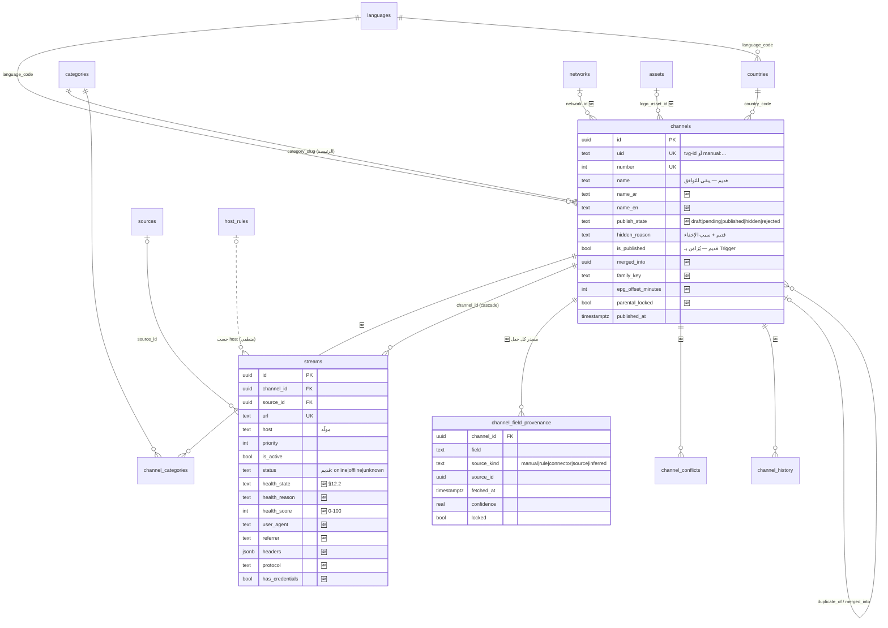
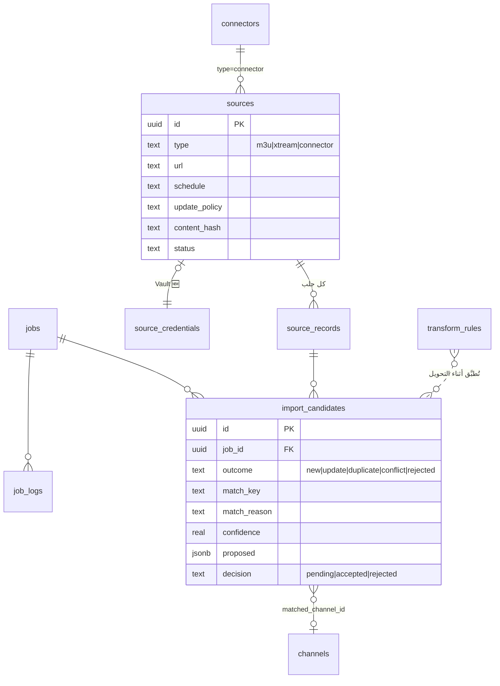
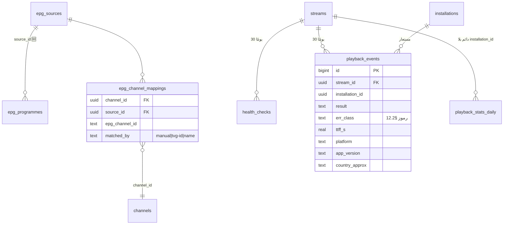
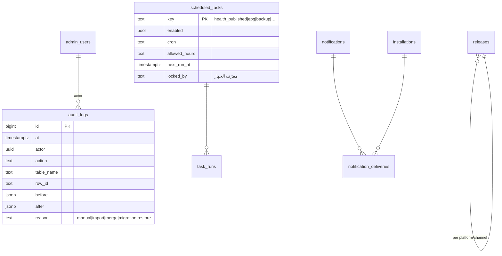

# مخطط قاعدة البيانات المستهدف (ERD) — مسودة المرحلة 0

> مبني على §16 ومقيّد بـ ADR-18 (إضافي ومتوافق للخلف). الأعمدة القديمة تبقى حتى R2 + 60 يومًا. يُراجع ويُعتمد ضمن بوابة C.
> الرموز: 🆕 جدول جديد · 🔄 جدول قائم يُطوَّر.

## 1. الكتالوج

## 2. الاستيراد والمصادر

## 3. EPG، الصحة، الإحصاءات

## 4. النظام والتواصل

## 5. قواعد يجب أن يحققها التنفيذ

- كل جدول جديد: RLS مفعّلة + سياسة `is_admin()` (مدير بجلسة MFA) + اختبار pgTAP.
- `catalog` و`catalog_streams`: نفس الأعمدة حتى R2 (تطبيق RN يقرؤها).
- Triggers توافق: `is_published`/`hidden_reason` ↔ `publish_state`، و`name` ↔ `name_ar`/`name_en`، و`epg_id` ↔ `epg_channel_mappings`.
- لا FK بين `epg_programmes` و`channels` (الربط عبر `epg_channel_mappings`)، كما هو اليوم.
